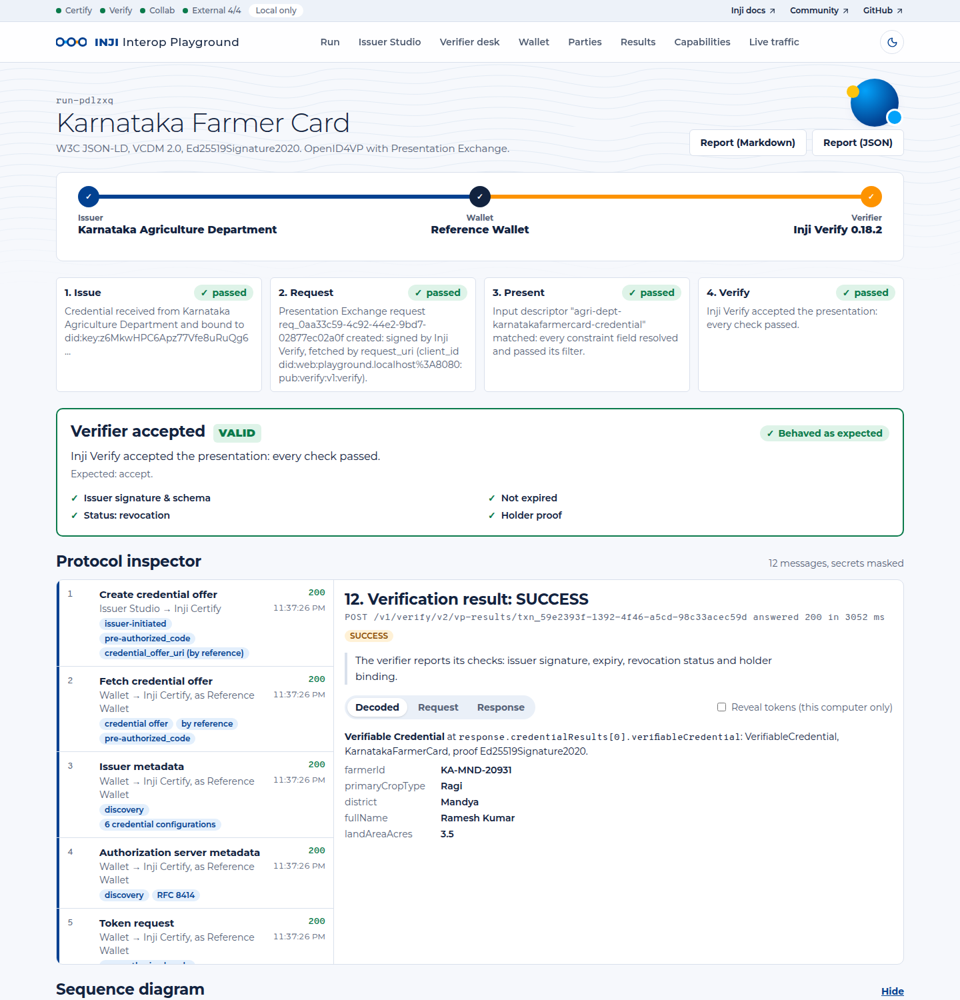
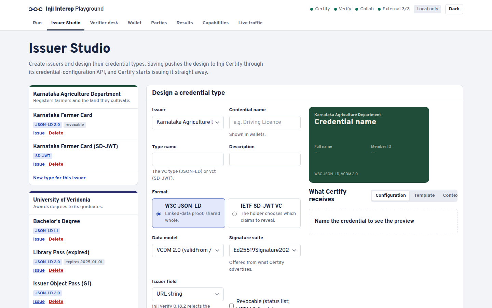
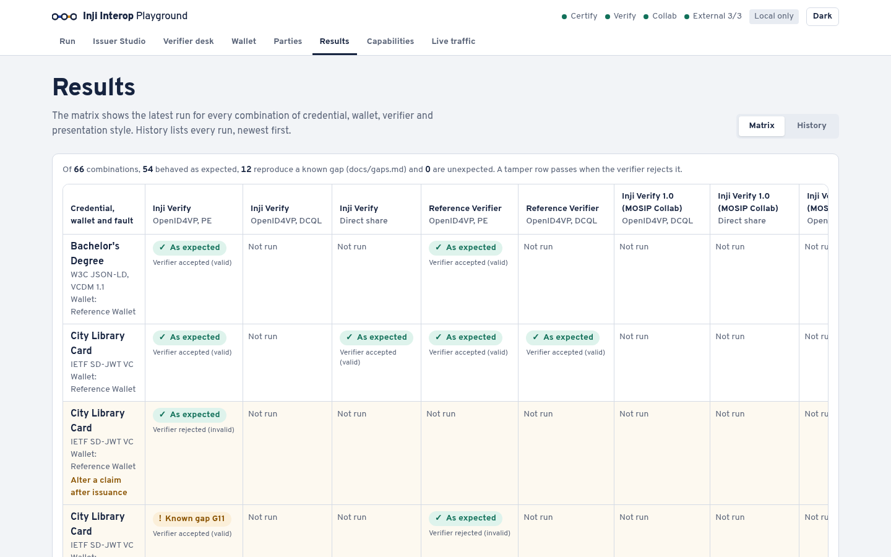
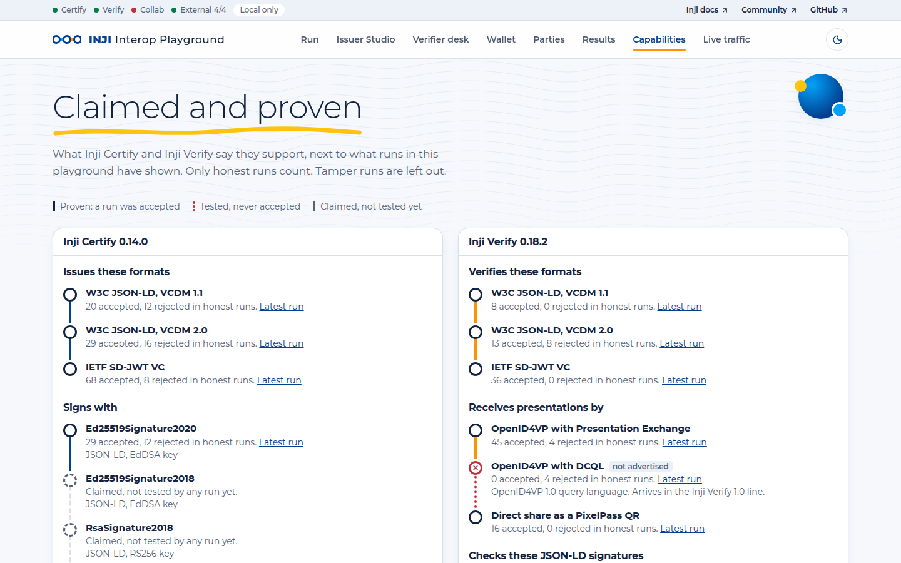
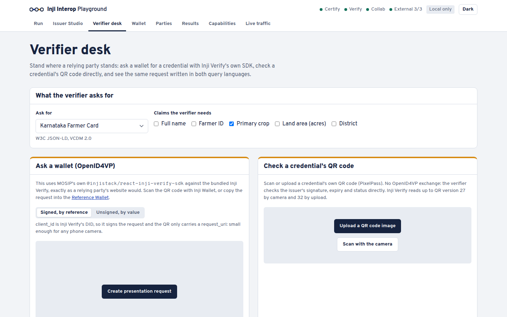
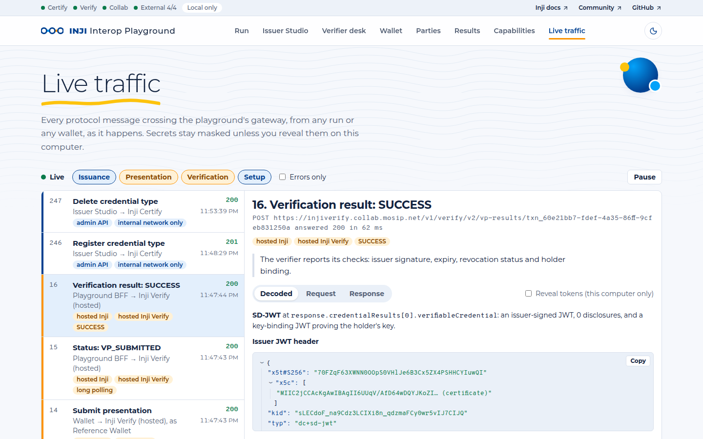
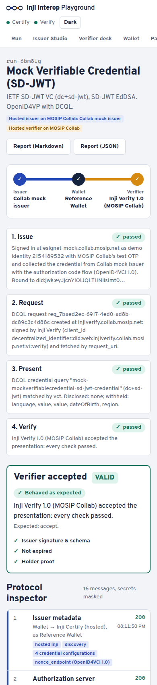
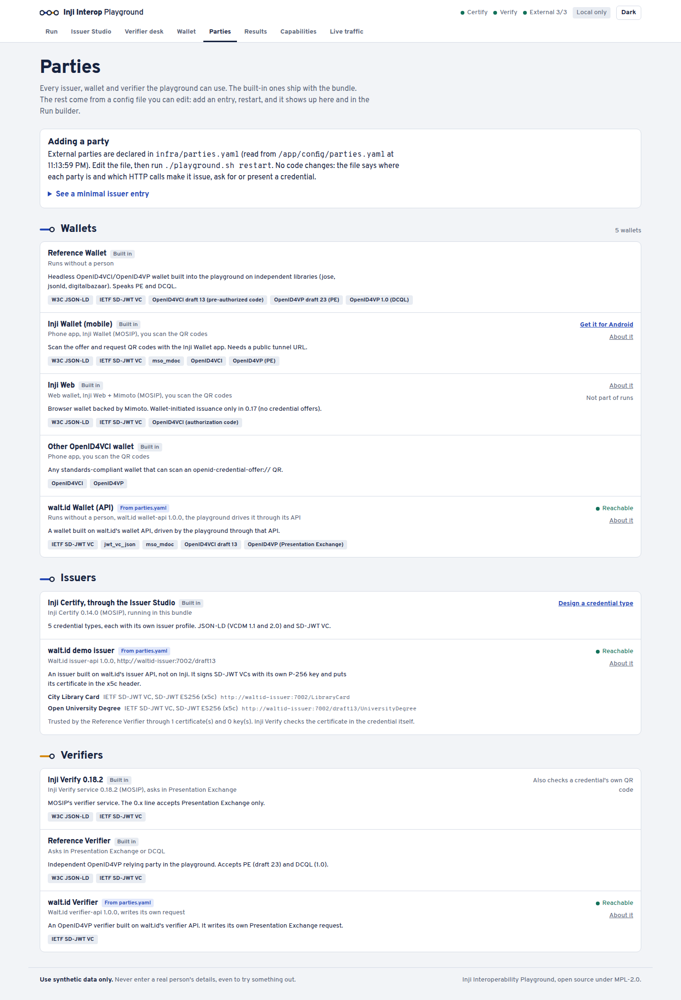
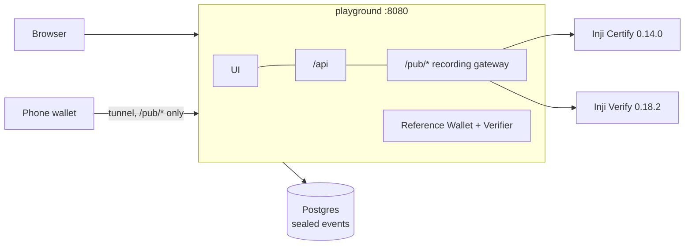

# Inji Interoperability Playground

<!-- CI badge: replace OWNER once the GitHub repository exists, then uncomment.
[](https://github.com/OWNER/inji-interop-playground/actions/workflows/ci.yml)
[](https://github.com/OWNER/inji-interop-playground/actions/workflows/nightly-interop.yml)
-->

The Inji Interoperability Playground is a lab for the whole Verifiable Credential lifecycle on MOSIP's Inji stack.
In it you can:

- **design** your own issuer and credential types;
- **issue** them through a real Inji Certify;
- **hold** them in a wallet;
- **present** them to a real Inji Verify or an independent verifier;
- **bring in parties that are not Inji** (other issuers, wallets and verifiers) by declaring them in a config
  file, with no code changes;
- **watch every protocol message** on the way.

Every journey ends in a PASS/FAIL verdict, and together the verdicts form an interoperability matrix that has
already surfaced real gaps between Inji components. It starts with one command.

Built for **MOSIP Decode 2026, problem statement 2**.



## Quickstart

You need **Docker** with Compose 2.20 or newer, about **6 GB of memory** for Docker (the bundle uses about
3 GB) and about 3 GB of disk for images. It runs on Linux and macOS; on Windows, use WSL2 (not tested).

```bash
git clone <repository-url> inji-interop-playground
cd inji-interop-playground
./playground.sh up        # builds the playground, starts Postgres, Inji Certify 0.14.0 and Inji Verify 0.18.2
```

Open **http://localhost:8080**. The first start downloads about 2 GB and takes a few minutes; Certify needs 1–3
minutes to boot. Demo issuers and credential types are created on first start.

```bash
./playground.sh doctor    # checks Docker, the containers and the gateway, and says what is wrong
./playground.sh down      # stops everything and keeps your data
./playground.sh logs certify   # follows one service's logs
./playground.sh reset     # deletes all data (asks first)
./playground.sh up --external   # also starts a non-Inji issuer, verifier and wallet (walt.id), see below
./playground.sh restart   # re-reads infra/parties.yaml after you edit it
```

## Your first five minutes

1. **Issuer Studio → Design a credential type.** Pick the *Karnataka Agriculture Department*, name the type,
   add fields, and choose a format (W3C JSON-LD with VCDM 1.1 or 2.0, or IETF SD-JWT VC) and a signature suite.
   The panel on the right shows exactly what Inji Certify will receive. Save: the playground pushes it to
   Certify's credential-configuration API, and Certify advertises it straight away.
2. **Run → Start run.** Choose your type, the **Reference Wallet** and **Inji Verify**. The transit line fills as
   the credential is issued (OpenID4VCI, pre-authorized code), requested (OpenID4VP with Presentation Exchange),
   presented and verified.
3. **Open the protocol inspector** on the run page. Every message is there in order, decoded and labelled. You
   can see the credential offer, the token exchange, the proof JWT over `c_nonce`, the issued credential, the
   presentation definition, the `vp_token` and Verify's result. Secrets are masked; *Reveal tokens* works on
   this computer only.
4. **Run it again with *Make the wallet misbehave* → Answer with a stale nonce**, once for the JSON-LD card and
   once for the SD-JWT card. Inji Verify rejects the first and accepts the second. That is gap G19.

## Running each flow

| Flow | How |
|---|---|
| **Design an issuer and credential types** | *Issuer Studio*. JSON-LD (VCDM 1.1 / 2.0, eight signature suites) or SD-JWT (ES256, EdDSA, RS256, ES256K), with optional revocation, selective disclosure per field, a hard-coded expiry, and branding. |
| **Issue to the Reference Wallet** | *Run* with wallet *Reference Wallet*, or *Wallet → Collect a credential* with any `openid-credential-offer://` link (also from other issuers). |
| **Issue to a phone** | *Run* with wallet *Inji Wallet (mobile)* in tunnel mode (below): scan the offer QR, or tap *Open in wallet app* on a phone. |
| **Present with OpenID4VP** | *Run* → *How the holder presents: OpenID4VP request*, with *Query language* Presentation Exchange or DCQL and *Ask only for* to limit the claims. |
| **Present by direct share** | *Run* → *Direct share*: the credential is compressed with PixelPass, as in a QR code, and checked by Inji Verify. |
| **Verify with Inji's own SDK** | *Verifier desk → Ask a wallet*: Inji Verify's React SDK shows a request QR for any wallet; *Check a credential's QR code* scans or uploads one. *One question, two query languages* shows the same request as PE and DCQL side by side. |
| **Answer any verifier** | *Wallet → Answer a verifier*: paste an `openid4vp://` request from Inji Verify, the Reference Verifier or another verifier. |
| **Tamper on purpose** | *Make the wallet misbehave*: alter a claim, answer with a stale nonce, drop the holder proof, present someone else's credential, or forge an SD-JWT with a self-signed certificate. A correct verifier rejects all five. |
| **Compare results** | *Results*: the matrix (latest run per combination) and the full history, filterable. Every run has a Markdown and JSON report with claim values redacted. |
| **Claimed vs proven** | *Capabilities*: what Certify and Verify advertise, against what runs here have shown. The **QR Lab** measures any credential against Certify's and Inji Verify's QR limits, with and without PixelPass. |
| **Watch everything** | *Live traffic*: every message through the gateway, as it happens. The **Decoder** takes any JWT, SD-JWT, offer, request or PixelPass string and explains it. |
| **Use parties that are not Inji** | *Parties* lists every issuer, wallet and verifier, built in or from `infra/parties.yaml`. Their credential types appear in *Run* and the *Verifier desk*, their wallets and verifiers in *Run*, and *Wallet → Collect from an external issuer* gets a credential from them (next section). |
| **Run the whole matrix** | `cd apps/bff && npx tsx scripts/matrix.ts` (needs `pnpm install` once): 31 journeys with Inji and the reference parties, plus 17 with external parties when the external lab is running. No human needed. |

| | | |
|---|---|---|
|  |  |  |
|  |  |  |

## Adding issuers, wallets and verifiers that are not Inji

External parties are **configuration, not code**. [infra/parties.yaml](infra/parties.yaml) lists each external
issuer (its OpenID4VCI address, its credential types and the claims they carry), each verifier and each wallet,
and describes how to talk to them as a few HTTP steps with placeholders (`${claims}`, `${offerUri}`,
`${requestUri}`…). Edit the file and run `./playground.sh restart`: the *Parties* page, the *Run* builder, the
*Verifier desk* and the *Wallet* page pick the change up. A broken entry is reported on the *Parties* page and
skipped; the rest still load.

- **An external issuer's credential, verified by Inji Verify.** Pick its type in *Run* and verifier *Inji
  Verify*. The playground asks the issuer for an offer (its `offer` steps), the wallet collects it, and Inji
  Verify requests and checks it like any Certify credential. An issuer without an offer API gets an
  `offerPage` instead; the run then asks you to paste an offer.
- **An external wallet.** A phone wallet needs only a name and install links: a person scans the QR codes. A
  wallet with an API can be driven by the playground (`automation.receive` / `automation.present`).
- **An external verifier.** Its `request` steps create an `openid4vp://` request and its `result` steps read the
  verdict; any wallet in the playground can then answer it.
- **Trust.** The Reference Verifier trusts an external issuer's SD-JWTs only through the certificates or keys the
  file lists under `trust`.

`./playground.sh up --external` starts a ready-made lab of three such parties from the **walt.id** community
stack (issuer, verifier and wallet APIs 1.0.0, see [infra/external/README.md](infra/external/README.md)); the
shipped `parties.yaml` describes them. They run only on the Docker network, so they are for local runs, not for
phones.



## Using a phone (Inji Wallet)

A phone wallet needs a public HTTPS URL to reach your computer. The playground can open a Cloudflare quick
tunnel without an account:

```bash
./playground.sh tunnel                         # or: ./playground.sh tunnel https://your.domain
./playground.sh doctor                         # checks the public URL too
```

- Install **Inji Wallet** on an Android phone. The APK is in the
  [MOSIP Collab guide's folder](https://drive.google.com/drive/folders/1SRHhFxQBNfOc-cdPU8VlKecIdc-WkuGZ);
  GitHub releases do not include one. Note the version you install.
- Start a run with wallet *Inji Wallet (mobile)* and scan the offer QR with the app, then the presentation
  request QR. The run waits up to 10 minutes for the phone and attributes its messages to the run, so the
  inspector fills just as it does for the Reference Wallet.
- In tunnel mode every party is identified by **did:web** on the public host. Only the wallet-facing gateway
  (`/pub/*`) is reachable through the URL; the UI and the API stay on your computer (`PUBLIC_UI=true` in `.env`
  opts them in).
- The quick-tunnel URL changes every time the tunnel restarts. `./playground.sh up` switches back to local mode.

## What it found

The matrix runs **31 journeys** against the real Inji Certify 0.14.0 and Inji Verify 0.18.2. Locally, over a
tunnel and on fresh volumes, the result is the same: **28 behave as expected, 3 are known gaps and 0 are
unexpected**. With the external lab, **17 more journeys** mix in walt.id's issuer, wallet and verifier: 12 behave
as expected and 5 are known gaps (48 in all, 0 unexpected).

| | Credential | Inji Verify 0.18.2 | Reference Verifier |
|---|---|---|---|
| Honest presentation, PE | JSON-LD 1.1 / 2.0, SD-JWT | ✅ accepted | ✅ accepted |
| Honest presentation, DCQL | JSON-LD 2.0, SD-JWT | ✗ not supported (0.x speaks PE only) | ✅ accepted |
| Direct share (PixelPass) | JSON-LD 2.0, SD-JWT | ✅ accepted | — |
| Expired credential | JSON-LD 2.0 | ✅ rejected | ✅ rejected |
| Altered claim, someone else's credential | both | ✅ rejected | ✅ rejected |
| Stale nonce, no holder proof, forged SD-JWT | SD-JWT | ❌ **accepted** | ✅ rejected |
| Honest presentation of an **external issuer's** SD-JWT (walt.id) | SD-JWT | ✅ accepted | ✅ accepted |
| An **external wallet** (walt.id) presenting | SD-JWT | ✅ accepted | ❌ rejected: its submission ids break PE (G33) |

The full report is [docs/interop-report.md](docs/interop-report.md). [docs/gaps.md](docs/gaps.md) lists
**34 gaps** with evidence and steps to reproduce. The headlines:

- **The version split is real.** Inji Verify 0.x accepts Presentation Exchange only. A DCQL request (the
  OpenID4VP 1.0 shape that Verify 1.0 uses) fails with a misleading `BOTH_ID_AND_PD_CANNOT_BE_NULL` (G22).
- **Three SD-JWT verification weaknesses in Inji Verify 0.18.2** (G11, G19, G20), each reproducible with one
  tamper preset. They are being reported to MOSIP privately.
- **The reference setups do not work out of the box.** At the released tags, broken database scripts and
  configuration stop every OpenID4VP submission, revocable credentials and pre-authorized issuance (G3, G4,
  G5), and Certify's keys are not persisted (G18). The bundle fixes each one in configuration only.
- **Certify caps the SD-JWT `vct` at 100 characters** (G24), found by running over a tunnel.
- **Inji and an independent stack meet halfway.** Inji Verify verifies walt.id's credentials and accepts its
  wallet, but walt.id's wallet cannot read Certify's issuer metadata (G30) and its verifier cannot read the
  holder key in Certify's SD-JWTs (G32).
- **QR codes are tighter than they look.** A credential with a 1 KB face photo already needs QR version 27,
  Inji Verify's camera limit. A Certify SD-JWT is 4.5 KB, three quarters of it certificate chain, and fits no
  QR code at all (G26).

## How it works

The playground container serves the UI, the API and a **recording gateway** on one origin. Wallets reach Inji
Certify and Inji Verify only through the gateway's allow-listed `/pub/*` routes. Every exchange is classified,
attributed to its run, sealed with AES-256-GCM and pushed live to the browser. Certify and Verify run as
released images with configuration only. A **Reference Wallet** and **Reference Verifier**, written from the
specs on independent libraries, are the second implementation that every Inji result is compared against.



| Document | What is in it |
|---|---|
| [docs/architecture.md](docs/architecture.md) | Components, the one-origin gateway, the reference parties, the event store, the live feed, local vs tunnel identities, Compose topology |
| [docs/api.md](docs/api.md) | Every `/api/*` route, the gateway's allow-list, the Reference Verifier and public documents |
| [docs/security-privacy.md](docs/security-privacy.md) | Synthetic data, sealing, masking, retention, what the tunnel exposes, what hosting it for others would need |
| [docs/test-results.md](docs/test-results.md) | Unit tests, the matrix in three modes, UI checks, known issues |
| [docs/interop-report.md](docs/interop-report.md) | The latest matrix run |
| [docs/gaps.md](docs/gaps.md) | Every gap with evidence, reproduction steps and where it should be reported |

## Coverage of the problem statement

| PS2 task | Status |
|---|---|
| Run the Inji stack end to end in one Docker Compose bundle | ✅ Certify + Verify + playground; Mimoto / Inji Web not bundled |
| Reverse proxy so a phone can reach it | ✅ one recording gateway, `./playground.sh tunnel` |
| Issuer → Wallet → Verifier UI, implementation chosen per section | ✅ |
| Create your own issuer and credential types | ✅ Issuer Studio, live in Certify |
| Issue over OpenID4VCI: offer QR on desktop, deep link on a phone | ✅ |
| Wallet-initiated issuance (Inji Web) | ☐ not yet |
| Present over OpenID4VP; Valid / Invalid / Valid-but-expired | ✅ cross-device QR (with a tappable `openid4vp://` link on a phone); PE and DCQL. A dedicated same-device mode is not in the UI yet |
| Direct share with PixelPass | ✅ |
| Protocol inspector with raw payloads, QR contents and the mechanism used | ✅ plus a live sequence diagram |
| Two formats end to end: W3C JSON-LD (VCDM 1.1 and 2.0) and IETF SD-JWT VC | ✅ |
| Pass/fail report per run | ✅ Markdown and JSON, redacted |
| Capabilities and QR limits | ✅ Capabilities page and QR Lab |
| PixelPass and the Inji Verify React SDK | ✅ |
| No plaintext PII at rest | ✅ AES-256-GCM sealing and a retention purge |
| Core services unmodified | ✅ configuration only |
| A non-Inji, standards-based party | ✅ Reference Wallet and Reference Verifier, plus walt.id's issuer, wallet and verifier in the external lab |
| External issuers, credential types, wallets and verifiers added by configuration (mentors, AMA 2) | ✅ `infra/parties.yaml` + `./playground.sh restart`, no code changes |
| A list of wallets (mentors, AMA 2) | ✅ *Parties* page |
| Replay and tamper | ✅ five presets |
| History dashboard | ✅ |
| Automated CI | ✅ CI and a nightly matrix workflow |
| Gap write-up | ✅ [gaps.md](docs/gaps.md); public issues to be linked |
| mDoc / mDL, deployment to Collab | ☐ not planned for this round |

## Versions and known limitations

| Component | Version |
|---|---|
| Inji Certify | 0.14.0 (`injistack/inji-certify-with-plugins`) |
| Inji Verify service / React SDK | 0.18.2 / 0.18.1 |
| PixelPass | 0.8.0 |
| External lab (optional) | walt.id issuer-api, verifier-api, wallet-api 1.0.0 |
| OpenID4VCI / OpenID4VP | draft 13 / draft 23 with PE (Inji Verify); PE and DCQL (Reference parties) |

- **One machine, one person.** The API has no login; it is safe because it is reachable only from this
  computer. See [security-privacy.md](docs/security-privacy.md) before hosting it anywhere else.
- **Use synthetic data only.** Nothing here is built for real identities.
- **Phone runs** are wired end to end (tunnel, did:web, attribution of the phone's messages), but the matrix
  covers them with the Reference Wallet rather than a physical phone.
- **Inji Verify 1.0 and Inji Web** are not in the bundle yet, so DCQL is exercised only against the Reference
  Verifier.
- **External parties** in the lab are reachable only inside Docker, so phone runs use Inji Certify. The parties
  file can describe internet-facing parties too; their traffic is recorded by the playground, but a phone's
  own calls to them are not (the run asks you to press *Continue*).
- At phone width some pages shift as data loads ([test-results.md](docs/test-results.md#ui-checks)).

## Development

```bash
pnpm install
pnpm typecheck && pnpm test && pnpm build
```

`packages/core` holds shared logic, `apps/bff` the API, gateway and reference parties, and `apps/ui` the React
app. To work on the BFF and the UI with live reload, run them on the host against the bundle's services (stop
the playground container first, since both use port 8080):

```bash
docker stop inji-playground-playground-1
docker compose --env-file .env -f infra/compose.yml -f infra/compose.dev.yml up -d   # Postgres, Certify, Verify on 127.0.0.1
cd apps/bff && DATABASE_URL=postgres://postgres:<POSTGRES_PASSWORD from .env>@127.0.0.1:5434/playground \
  EVENT_ENCRYPTION_KEY=<from .env> npx tsx src/main.ts                               # API + gateway on :8080
cd apps/ui && npx vite                                                               # UI with hot reload, proxied to :8080
```

`./playground.sh up` returns to the containerised bundle.

## Licence

[MPL-2.0](LICENSE), the same licence as Inji. Inji Certify, Inji Verify, the Inji Verify SDK and PixelPass are
MOSIP projects (MPL-2.0), used here as released.

Third-party parts, all under OSI-approved licences and unmodified:

| Part | Licence |
|---|---|
| walt.id issuer-api, verifier-api, wallet-api 1.0.0 (optional external lab) | Apache-2.0 |
| cloudflared (tunnel mode only) | Apache-2.0 |
| PostgreSQL 15 | PostgreSQL License |
| npm dependencies (`pnpm licenses list --prod`) | MIT, BSD, ISC, Apache-2.0, MPL-2.0, 0BSD, Zlib; Overpass fonts under OFL-1.1; jszip used under its MIT option |
