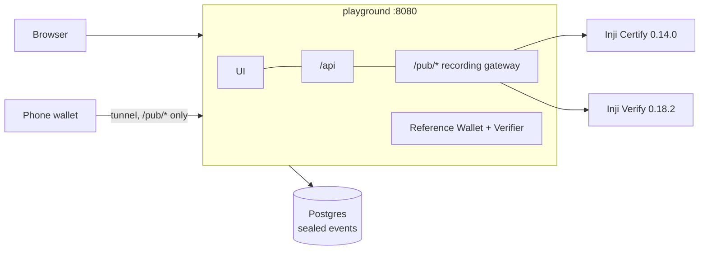

# Inji Interoperability Playground

[](https://github.com/Akshats-git/inji-interop-playground/actions/workflows/ci.yml)
[](https://github.com/Akshats-git/inji-interop-playground/actions/workflows/nightly-interop.yml)

A lab for the whole Verifiable Credential lifecycle on MOSIP's Inji stack. Built for MOSIP Decode 2026, problem statement 2.

With it you can:

- **Design** your own issuer and credential types.
- **Issue** them through a real Inji Certify.
- **Hold** them in a wallet.
- **Present** them to a real Inji Verify or to an independent verifier.
- **Connect to MOSIP Collab**, MOSIP's hosted sandbox, and use its issuers, eSignet and Inji Verify 1.0.
- **Add parties that are not Inji** by listing them in a config file. No code changes.
- **Watch every protocol message** as it happens.

Every journey ends with a PASS or FAIL verdict. The verdicts form an interoperability matrix. That matrix has already found real gaps between Inji components.


## Contents

1. [Quickstart](#quickstart)
2. [Your first five minutes](#your-first-five-minutes)
3. [What you can do](#what-you-can-do)
4. [Results](#results)
5. [How it works](#how-it-works)
6. [Coverage of the problem statement](#coverage-of-the-problem-statement)
7. [Versions and known limits](#versions-and-known-limits)
8. [Development](#development)
9. [Licence](#licence)

## Quickstart

### What you need

| Need | Details |
|---|---|
| Docker | Compose 2.20 or newer |
| Memory | Give Docker about 6 GB. The bundle uses about 3 GB. |
| Disk | About 3 GB free for images |
| Operating system | Linux or macOS. On Windows, use WSL2 (not tested). |
| Internet | Needed for the first start (about 2 GB of images) and for the MOSIP Collab and Animo journeys |

### Start it

```bash
git clone https://github.com/Akshats-git/inji-interop-playground
cd inji-interop-playground
./playground.sh up
```

The first start builds the playground and starts Postgres, Inji Certify 0.14.0 and Inji Verify 0.18.2.
It takes a few minutes. Certify needs 1 to 3 more minutes to boot.
The demo issuers and credential types are created on the first start.

Then open **http://localhost:8080**.

### Other commands

| Command | What it does |
|---|---|
| `./playground.sh doctor` | Checks Docker, the containers and the gateway, and says what is wrong |
| `./playground.sh up --external` | Also starts a non-Inji issuer, verifier and wallet (walt.id) |
| `./playground.sh restart` | Re-reads `infra/parties.yaml` after you edit it |
| `./playground.sh tunnel` | Starts with a public HTTPS URL so a phone wallet can connect |
| `./playground.sh logs certify` | Follows the logs of one service |
| `./playground.sh down` | Stops everything and keeps your data |
| `./playground.sh reset` | Deletes all data (asks first) |

## Your first five minutes

1. **Design a credential type.** Open *Issuer Studio* and choose *Design a credential type*.
   - Pick the *Karnataka Agriculture Department* and name the type. Add some fields.
   - Choose a format (W3C JSON-LD with VCDM 1.1 or 2.0, or IETF SD-JWT VC) and a signature suite.
   - The panel on the right shows exactly what Inji Certify will receive.
   - When you save, the type is pushed to Certify, and Certify starts advertising it.
2. **Run a journey.** Open *Run* and choose three parties.
   - Issuer: your type. Wallet: *Reference Wallet*. Verifier: *Inji Verify*.
   - Press *Start run*. The transit line fills as the credential is issued, requested, presented and verified.
   - The result says **Valid**, **Invalid** or **Valid but expired**. Try *Library Pass (expired)* to see the last one.
3. **Open the protocol inspector** on the run page.
   - Every message is there, in order, decoded and labelled.
   - You can see the credential offer, the token exchange, the proof over `c_nonce`, the issued credential and Verify's result.
   - Secrets are masked. *Reveal tokens* only works on this computer.
4. **Make the wallet misbehave.** Run again with *Make the wallet misbehave* set to *Answer with a stale nonce*.
   - Do it once for the JSON-LD card and once for the SD-JWT card.
   - Inji Verify treats the two differently. That is a known gap (G19, details withheld).

## What you can do

| Task | Where |
|---|---|
| Design issuers and credential types | *Issuer Studio* |
| Issue, present and verify a credential | *Run* |
| Ask a wallet for a credential with Inji's own SDK | *Verifier desk* |
| Collect, hold and present credentials | *Wallet* |
| See every issuer, wallet and verifier | *Parties* |
| Compare results across runs | *Results* |
| Compare claimed and proven support, and measure QR size | *Capabilities* |
| Watch the traffic as it happens | *Live traffic* |

The steps for each flow are in [docs/usage.md](docs/usage.md).

| | | |
|---|---|---|
|  |  |  |
|  |  |  |

### Guides

| Guide | What it covers |
|---|---|
| [Run each flow](docs/usage.md#run-each-flow) | A table of every flow, with where to click |
| [Connect to MOSIP Collab](docs/usage.md#connect-to-mosip-collab) | Issuers, eSignet sign-in, test data and Inji Verify 1.0 |
| [Use a phone](docs/usage.md#use-a-phone) | The tunnel and Inji Wallet 1.0.0-alpha.1 |
| [Add parties that are not Inji](docs/usage.md#add-parties-that-are-not-inji) | `infra/parties.yaml`, walt.id and Animo |
| [Run the whole matrix](docs/usage.md#run-the-whole-matrix) | One command, no person needed |

## Results

The matrix runs **75 journeys**. They are grouped like this:

| Group | Journeys | What it covers |
|---|---|---|
| Local | 33 | The real Inji Certify 0.14.0 and Inji Verify 0.18.2, with the reference parties |
| External lab | 18 | Mixes in walt.id's issuer, wallet and verifier |
| MOSIP Collab | 20 | Inji 1.0.0-alpha.1 |
| Animo | 4 | A credential from Animo's hosted playground |

**62 behave as expected, 13 are known gaps and 0 are unexpected** (24 Oct 2026). A GitHub runner reproduced the same numbers from a fresh start on 25 Oct ([report](docs/evidence/matrix-2026-10-25-github-nightly.md)). A re-run on 26 Oct against the live stack gave them again ([report](docs/evidence/matrix-2026-10-26-live-rerun.md)).

The Results page shows 70 cells, not 75. Five journeys share a cell with another journey (same credential, wallet, verifier and fault).

The full report is [docs/interop-report.md](docs/interop-report.md). [docs/gaps.md](docs/gaps.md) lists **41 gaps**, each with evidence and steps to reproduce. The main ones:

- **The version split is real (G22).** Inji Verify 0.x accepts Presentation Exchange only. Verify 1.0 accepts DCQL only. Sent a DCQL request, 0.x fails with a misleading `BOTH_ID_AND_PD_CANNOT_BE_NULL`.
- **Inji Verify has SD-JWT verification weaknesses (G11, G19, G20).** The 1.0.0-alpha.1 on Collab fixes two and still has G11. The details are not published here.
- **Collab's Verify 1.0 reads DCQL claim paths differently from OpenID4VP 1.0 (G36).** A request written to the spec makes it reject honest presentations.
- **The reference setups do not work out of the box (G3, G4, G5, G18).** At the released tags, broken database scripts and configuration stop OpenID4VP submissions, revocable credentials and pre-authorized issuance. The bundle fixes each one with configuration only.
- **Certify caps the SD-JWT `vct` at 100 characters (G24).**
- **Inji and an independent stack only meet halfway (G30, G32).** Inji Verify verifies walt.id's credentials. But walt.id's wallet cannot read Certify's issuer metadata, and its verifier cannot read the holder key in Certify's SD-JWTs.
- **QR codes are tighter than they look (G26).** A Certify SD-JWT is 4.5 KB. It fits in no QR code.

## How it works

One playground container serves the UI, the API and a **recording gateway** on a single origin.

- Wallets reach Inji Certify and Inji Verify only through the gateway's allow-listed `/pub/*` routes.
- The gateway classifies each exchange and attributes it to its run. It seals the exchange with AES-256-GCM and pushes it live to the browser.
- Certify and Verify run as released images, with configuration only.
- A **Reference Wallet** and a **Reference Verifier** are written from the specs, on independent libraries. Every Inji result is compared against them.



| Document | What is in it |
|---|---|
| [docs/usage.md](docs/usage.md) | How to run each flow, connect to Collab, use a phone and add parties |
| [docs/architecture.md](docs/architecture.md) | Components, the gateway, the reference parties, the event store and the Compose layout |
| [docs/api.md](docs/api.md) | Every `/api/*` route, the gateway's allow-list and the public documents |
| [docs/security-privacy.md](docs/security-privacy.md) | Synthetic data, sealing, masking, retention and what the tunnel exposes |
| [docs/test-results.md](docs/test-results.md) | Unit tests, the matrix in three modes, UI checks and known issues |
| [docs/interop-report.md](docs/interop-report.md) | The latest matrix run |
| [docs/gaps.md](docs/gaps.md) | Every gap, with evidence, reproduction steps and where to report it |

## Coverage of the problem statement

✅ done · ◐ partly done · ☐ not done

| PS2 task | Status |
|---|---|
| Connect to the MOSIP Collab services (the main target, AMA 4) | ✅ Collab's Certify issuers, eSignet and Inji Verify 1.0 are parties. Collab's Mimoto supplies the issuer list. |
| Run the Inji stack in one Docker Compose bundle | ✅ Certify, Verify and the playground. Mimoto and Inji Web are not bundled, because Collab's are used. |
| Reverse proxy so a phone can reach it | ✅ One recording gateway and `./playground.sh tunnel` |
| Issuer, Wallet and Verifier UI, with the implementation chosen per section | ✅ Three columns on the *Run* page |
| Create your own issuer and credential types | ✅ *Issuer Studio*, live in Certify |
| Issue over OpenID4VCI with an offer QR on desktop and a deep link on a phone | ✅ Pre-authorized code on the bundled Certify |
| Both pre-authorized and authorization-code issuance, with test data next to the sign-in | ✅ Authorization code (PKCE, `private_key_jwt`) on Collab, with the demo UINs and OTP beside it |
| Wallet-initiated issuance (Inji Web) | ☐ Not built |
| Present over OpenID4VP and show Valid, Invalid or Valid-but-expired | ✅ Cross-device QR signed by Inji Verify, same-device deep link, PE and DCQL |
| Direct share with PixelPass | ✅ |
| Protocol inspector with raw payloads, QR contents and the mechanism used | ✅ Plus a live sequence diagram |
| Two formats end to end: W3C JSON-LD (VCDM 1.1 and 2.0) and IETF SD-JWT VC | ✅ |
| Pass/fail report per run | ✅ Markdown and JSON, redacted |
| Capabilities and QR limits | ✅ *Capabilities* page and *QR Lab* |
| PixelPass and the Inji Verify React SDK | ✅ |
| No plaintext PII at rest | ✅ AES-256-GCM sealing and a retention purge |
| Core services unmodified | ✅ Configuration only |
| A non-Inji, standards-based party | ✅ Reference Wallet and Verifier, plus walt.id and Animo |
| External parties added by configuration (AMA 2) | ✅ `infra/parties.yaml` and `./playground.sh restart` |
| A list of wallets (AMA 2) | ✅ *Parties* page |
| Replay and tamper | ✅ Five presets |
| History dashboard | ✅ |
| Automated CI | ✅ CI and a nightly matrix workflow. Both have run on GitHub. |
| Gap write-up | ✅ [gaps.md](docs/gaps.md). Public issues are not filed yet. |
| mDoc / mDL | ◐ The Reference Wallet collects the `mso_mdoc` from Collab's mDL issuer. No verifier here can check it, because Inji Verify does not support it. |

## Versions and known limits

### Versions

| Component | Version |
|---|---|
| Inji Certify | 0.14.0 (`injistack/inji-certify-with-plugins`) |
| Inji Verify service / React SDK | 0.18.2 / 0.18.1 |
| PixelPass | 0.8.0 |
| MOSIP Collab (hosted, checked 23 Oct 2026) | Inji Verify 1.0.0-alpha.1, Certify issuers on the 1.0 and 0.x lines, eSignet and Mimoto |
| External lab (optional) | walt.id issuer-api, verifier-api and wallet-api 1.0.0 |
| OpenID4VCI / OpenID4VP | Draft 13 / draft 23 with PE (bundled Inji Verify). 1.0 / 1.0 with DCQL (Collab). Both (Reference parties). |

### Known limits

- **One machine, one person.** The API has no login. That is safe only because it can be reached from this computer alone. Read [security-privacy.md](docs/security-privacy.md) before hosting it anywhere else.
- **Use synthetic data only.** Nothing here is built for real identities.
- **The local bundle runs the stable 0.x line.** Images tagged `1.0.0-alpha.1` exist for Certify and Verify, but they are not bundled. Collab runs the 1.0 line, so the 1.0 journeys go through Collab. Inji Web is not bundled either.
- **Collab is shared and can change.** Its findings are dated 23 Oct 2026. The Collab rows need internet and skip themselves without it.
- **No physical phone run is recorded.** Phone flows are wired end to end, but the matrix covers them with the Reference Wallet. It is not known whether the alpha wallet accepts an offer scanned from outside Mimoto's issuer list.
- **mDoc can be collected but not verified.** No verifier supports `mso_mdoc`.
- **External parties in the lab are reachable only inside Docker.** Phone runs use Inji Certify. The parties file can describe internet-facing parties too. For those, the run asks you to press *Continue* after the phone acts.
- **Run history is kept for 30 days** by default. Change `RETENTION_DAYS` in `.env` to keep it longer or shorter.

## Development

```bash
pnpm install
pnpm typecheck && pnpm test && pnpm build
```

| Folder | What is in it |
|---|---|
| `packages/core` | Shared logic |
| `apps/bff` | The API, the gateway and the reference parties |
| `apps/ui` | The React app |

To work on the API and the UI with live reload, run them on the host against the bundle's services. Stop the playground container first, because both use port 8080.

```bash
docker stop inji-playground-playground-1
docker compose --env-file .env -f infra/compose.yml -f infra/compose.dev.yml up -d   # Postgres, Certify, Verify on 127.0.0.1
cd apps/bff && DATABASE_URL=postgres://postgres:<POSTGRES_PASSWORD from .env>@127.0.0.1:5434/playground \
  EVENT_ENCRYPTION_KEY=<from .env> VERIFY_DID=<from .env> npx tsx src/main.ts          # API and gateway on :8080
cd apps/ui && npx vite                                                                   # UI with hot reload, proxied to :8080
```

`./playground.sh up` returns to the containerised bundle.

## Licence

[MPL-2.0](LICENSE), the same licence as Inji. Inji Certify, Inji Verify, the Inji Verify SDK and PixelPass are MOSIP projects (MPL-2.0). They are used here as released.

The third-party parts are all under OSI-approved licences and are unmodified:

| Part | Licence |
|---|---|
| walt.id issuer-api, verifier-api, wallet-api 1.0.0 (optional external lab) | Apache-2.0 |
| cloudflared (tunnel mode only) | Apache-2.0 |
| PostgreSQL 15 | PostgreSQL License |
| npm dependencies (`pnpm licenses list --prod`) | MIT, BSD, ISC, Apache-2.0, MPL-2.0, 0BSD, Zlib. Montserrat and Overpass Mono fonts under OFL-1.1. lucide-react under ISC. jszip used under its MIT option. |
