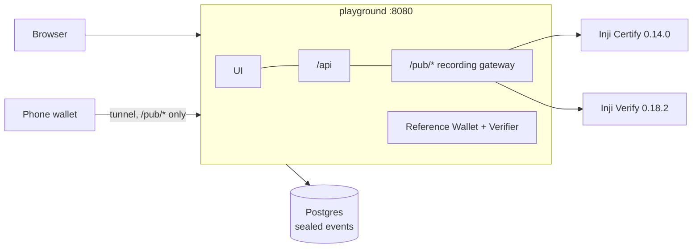

# Inji Interoperability Playground

[](https://github.com/Akshats-git/inji-interop-playground/actions/workflows/ci.yml)
[](https://github.com/Akshats-git/inji-interop-playground/actions/workflows/nightly-interop.yml)

The Inji Interoperability Playground is a lab for the whole Verifiable Credential lifecycle on MOSIP's Inji stack.
With it you can:

- **design** your own issuer and credential types;
- **issue** them through a real Inji Certify;
- **hold** them in a wallet;
- **connect to MOSIP Collab**, MOSIP's hosted sandbox, and use its issuers, eSignet and Inji Verify 1.0;
- **present** them to a real Inji Verify or to an independent verifier;
- **bring in parties that are not Inji** (other issuers, wallets and verifiers) by listing them in a config
  file, with no code changes;
- **watch every protocol message** as it happens.

Every journey ends with a PASS or FAIL verdict. Together the verdicts form an interoperability matrix, and that
matrix has already found real gaps between Inji components. You start it with one command.

Built for **MOSIP Decode 2026, problem statement 2**.


## Quickstart

You need **Docker** with Compose 2.20 or newer. Give Docker about **6 GB of memory** (the bundle uses about
3 GB) and keep about 3 GB of disk free for images. It runs on Linux and macOS. On Windows, use WSL2. I have not
tested that.

```bash
git clone https://github.com/Akshats-git/inji-interop-playground inji-interop-playground
cd inji-interop-playground
./playground.sh up        # builds the playground, starts Postgres, Inji Certify 0.14.0 and Inji Verify 0.18.2
```

Open **http://localhost:8080**. The first start downloads about 2 GB and takes a few minutes. Certify needs 1 to 3
more minutes to boot. The demo issuers and credential types are created on the first start.

```bash
./playground.sh doctor    # checks Docker, the containers and the gateway, and says what is wrong
./playground.sh down      # stops everything and keeps your data
./playground.sh logs certify   # follows the logs of one service
./playground.sh reset     # deletes all data (asks first)
./playground.sh up --external   # also starts a non-Inji issuer, verifier and wallet (walt.id), see below
./playground.sh restart   # re-reads infra/parties.yaml after you edit it
```

## Your first five minutes

1. **Issuer Studio, then Design a credential type.** Pick the *Karnataka Agriculture Department* and name the
   type. Add some fields. Choose a format (W3C JSON-LD with VCDM 1.1 or 2.0, or IETF SD-JWT VC) and a signature
   suite. The panel on the right shows exactly what Inji Certify will receive. When you save, the playground
   pushes the type to Certify's credential-configuration API, and Certify starts advertising it straight away.
2. **Run, then Start run.** Pick the three parties in the **Issuer, Wallet and Verifier** columns. Use your type,
   the **Reference Wallet** and **Inji Verify**. The transit line fills as the credential is issued (OpenID4VCI,
   pre-authorized code), requested (OpenID4VP with Presentation Exchange, signed by Inji Verify), presented and
   verified. The result says **Valid**, **Invalid** or **Valid but expired**. Try *Library Pass (expired)* to see
   the last one.
3. **Open the protocol inspector** on the run page. Every message is there, in order, decoded and labelled. You
   can see the credential offer, the token exchange, the proof JWT over `c_nonce`, the issued credential, the
   presentation definition, the `vp_token` and Verify's result. Secrets are masked. *Reveal tokens* only works on
   this computer.
4. **Run it again with *Make the wallet misbehave*, then *Answer with a stale nonce*.** Do it once for the JSON-LD
   card and once for the SD-JWT card. Inji Verify treats the two differently. That is a known gap (G19, details
   withheld).

## Running each flow

| Flow | How |
|---|---|
| **Design an issuer and credential types** | Open *Issuer Studio*. You can use JSON-LD (VCDM 1.1 or 2.0, eight signature suites) or SD-JWT (ES256, EdDSA, RS256, ES256K). Options include revocation, selective disclosure per field, a fixed expiry and branding. |
| **Issue to the Reference Wallet** | Use *Run* with the wallet *Reference Wallet*. Or use *Wallet, then Collect a credential* with any `openid-credential-offer://` link, including links from other issuers. |
| **Issue to a phone** | Use *Run* with the wallet *Inji Wallet (mobile)* in tunnel mode (see below). Scan the offer QR, or tap *Open in wallet app* on the phone. |
| **Present with OpenID4VP** | Use *Run*, then *How the holder presents: OpenID4VP request*. Pick the *Query language* (Presentation Exchange or DCQL) and use *The verifier asks only for* to limit the claims. With Inji Verify you can choose *Signed, by reference* (the default: Verify's did:web as `client_id`, and a small `request_uri` QR) or *Unsigned, by value* (gap G25). |
| **Present by direct share** | Use *Run*, then *Direct share*. The credential is compressed with PixelPass, as in a QR code, and Inji Verify checks it. |
| **Verify with Inji's own SDK** | Use *Verifier desk, then Ask a wallet*. Inji Verify's React SDK shows a request QR that any wallet can scan (cross-device). On a phone, the SDK's same-device button opens the wallet app through an `openid4vp://` deep link. *Check a credential's QR code* scans or uploads a QR. *One question, two query languages* shows the same request as PE and DCQL side by side. |
| **Answer any verifier** | Use *Wallet, then Answer a verifier*. Paste an `openid4vp://` request from Inji Verify, the Reference Verifier or another verifier. |
| **Tamper on purpose** | Use *Make the wallet misbehave*. You can alter a claim, answer with a stale nonce, drop the holder proof, present someone else's credential, or forge an SD-JWT with a self-signed certificate. A correct verifier rejects all five. |
| **Compare results** | Open *Results*. You get the matrix (the latest run per credential, wallet, verifier and presentation style, with documented upstream gaps marked by their id) and the full history, which you can filter. Every run has a Markdown and a JSON report with the claim values redacted. |
| **Claimed vs proven** | Open *Capabilities*. It compares what Certify and Verify advertise with what the runs here have shown. The **QR Lab** measures any credential against the QR limits of Certify and Inji Verify, with and without PixelPass. |
| **Watch everything** | Open *Live traffic* to see every message through the gateway as it happens. The **Decoder** takes any JWT, SD-JWT, offer, request or PixelPass string and explains it. |
| **Use parties that are not Inji** | *Parties* lists every issuer, wallet and verifier, built in or from `infra/parties.yaml`. Their credential types show up in *Run* and the *Verifier desk*. Their wallets and verifiers show up in *Run*. *Wallet, then Collect from an external issuer* gets a credential from them (see the next section). |
| **Run the whole matrix** | Run `cd apps/bff && npx tsx scripts/matrix.ts` (you need `pnpm install` once). It runs 33 journeys with Inji and the reference parties, plus 18 with external parties when the external lab is running. No person is needed. |

| | | |
|---|---|---|
|  |  |  |
|  |  |  |

## Adding issuers, wallets and verifiers that are not Inji

External parties are **configuration, not code**. [infra/parties.yaml](infra/parties.yaml) lists each external
issuer (its OpenID4VCI address, its credential types and the claims they carry), each verifier and each wallet.
It describes how to talk to them as a few HTTP steps with placeholders such as `${claims}`, `${offerUri}` and
`${requestUri}`. Edit the file and run `./playground.sh restart`. The *Parties* page, the *Run* builder, the
*Verifier desk* and the *Wallet* page pick up the change. If an entry is broken, the *Parties* page reports it
and skips it. The rest still load.

- **An external issuer's credential, verified by Inji Verify.** Pick its type in *Run* and choose the verifier
  *Inji Verify*. The playground asks the issuer for an offer (its `offer` steps), the wallet collects it, and
  Inji Verify requests and checks it like any Certify credential. An issuer without an offer API gets an
  `offerPage` instead. The run then asks you to paste an offer.
- **An external wallet.** A phone wallet only needs a name and install links, because a person scans the QR codes.
  A wallet with an API can be driven by the playground (`automation.receive` and `automation.present`).
- **An external verifier.** Its `request` steps create an `openid4vp://` request and its `result` steps read the
  verdict. Any wallet in the playground can then answer it.
- **Trust.** The Reference Verifier only trusts an external issuer's SD-JWTs through the certificates or keys the
  file lists under `trust`.

`./playground.sh up --external` starts a ready-made lab of three such parties from the **walt.id** community
stack. It has an issuer, a verifier and a wallet, all API version 1.0.0 (see
[infra/external/README.md](infra/external/README.md)). The shipped `parties.yaml` describes them. They only run
on the Docker network, so they work for local runs but not for phones.

The file also lists **Animo's hosted OpenID4VC playground** (<https://playground.animo.id>). It is built on Credo,
not Inji, and it is the external stack the mentors named. It needs no lab. Its API creates a pre-authorized offer
for a `dc+sd-jwt` Tax-ID on request. The Reference Wallet collects it, and Inji Verify 0.18.2 and Collab's Verify
1.0 verify it (matrix rows A1 to A4). The Reference Verifier refuses it only because Animo's certificate is not
in its trust list. I checked that by hand, so it is not a matrix row. You can add Animo's other issuers the same
way.

I also looked at **Hovi's test bed** (<https://playground.hovi.id>). It is a browser app on a private backend
with no documented issuer or offer API. The only way to use it is to scan its QR codes with a phone wallet.


## Connecting to MOSIP Collab

MOSIP's hosted sandbox, **Collab**, is the playground's main target (AMA 4). The playground runs on your machine
and connects to Collab's Inji Certify issuers, eSignet, Mimoto and **Inji Verify 1.0**. The local bundle adds
pre-authorized issuance, tampering and CI. You don't need to configure anything. `./playground.sh up` fetches
MOSIP's published test client key (`wallet-demo`) into `infra/collab/keys/`. The **Collab** dot in the header
turns green when the sandbox is reachable.

- **Run, then "MOSIP Collab, end to end"** (or pick any *MOSIP Collab* issuer and *Inji Verify 1.0 (MOSIP
  Collab)*). Collab only issues with the **authorization code flow**. So the Reference Wallet signs in at eSignet
  by itself, using one of MOSIP's public demo UINs and the static OTP `111111`. Then it collects and presents the
  credential. Choose *I'll sign in myself* to do the eSignet step in your own browser instead (redirect
  `http://localhost:3004`).
- **Wallet, then Collect from MOSIP Collab** collects any Collab credential. That includes the Mock VC in VCDM
  1.1 and 2.0 and SD-JWT, Farmer, Land registry, the mDL as `mso_mdoc`, and more. Next to every sign-in, the
  **test data** panel lists the demo UINs, the OTP and how to register your own UIN.
- **Phone:** Collab's issuers need no tunnel. Install **Inji Wallet 1.0.0-alpha.1**
  ([Android APK](https://drive.google.com/drive/folders/1gBjFSdpjxU4bsZi7-xS59W1-EIFKrkS8),
  [iOS TestFlight](https://testflight.apple.com/join/7FTAdjLe)). Choose the issuer in the app and sign in with a
  demo UIN and OTP `111111`. Then present to Collab's Inji Verify. This is the path Swati described at AMA 4. The
  playground's automated runs use the Reference Wallet instead, and I have not yet recorded a run on a physical
  phone.
- **What it found there:** Collab's Verify 1.0 fixes G19 and G20, but G11 is still there (details withheld). It
  also reads DCQL claim paths differently from OpenID4VP 1.0 (G36). Nobody can verify Collab's Land registry
  credentials (G41). See [docs/gaps.md](docs/gaps.md) (G36 to G41).
- Inji Verify 1.0 speaks **DCQL only**, and it **does not support `mso_mdoc`** (AMA 4).


- Collab is shared and can change at any time. The findings are dated 23 Oct 2026 and name the versions I saw.
  With no internet, the matrix skips the C rows and everything local still works.

## Using a phone (Inji Wallet)

A phone wallet needs a public HTTPS URL to reach your computer. The playground can open a Cloudflare quick
tunnel without an account:

```bash
./playground.sh tunnel                         # or: ./playground.sh tunnel https://your.domain
./playground.sh doctor                         # checks the public URL too
```

- Install **Inji Wallet 1.0.0-alpha.1**. This is the version MOSIP points to at collab.mosip.net. Get the
  [Android APK](https://drive.google.com/drive/folders/1gBjFSdpjxU4bsZi7-xS59W1-EIFKrkS8) or the
  [iOS TestFlight](https://testflight.apple.com/join/7FTAdjLe). The GitHub releases don't include one. I have
  not tested on a physical phone whether this alpha can collect a credential from the bundled Certify 0.14.
- Start a run with the wallet *Inji Wallet (mobile)*. Scan the offer QR with the app, then the presentation
  request QR. The run waits up to 10 minutes for the phone. It attributes the phone's messages to the run, so the
  inspector fills just as it does for the Reference Wallet.
- In tunnel mode, every party is identified by **did:web** on the public host. Only the wallet-facing gateway
  (`/pub/*`) can be reached through the URL. The UI and the API stay on your computer. Set `PUBLIC_UI=true` in
  `.env` to expose them too.
- The quick-tunnel URL changes every time the tunnel restarts. `./playground.sh up` switches back to local mode.

## What it found

The matrix runs **75 journeys**:

- 33 against the real Inji Certify 0.14.0 and Inji Verify 0.18.2;
- 18 more that mix in walt.id's issuer, wallet and verifier (the external lab);
- 20 against **MOSIP Collab** (Inji 1.0.0-alpha.1);
- 4 with a credential from **Animo's** hosted playground.

**62 behave as expected, 13 are known gaps and 0 are unexpected** (24 Oct 2026). The Results page shows 70
cells, not 75. That is because five journeys share a cell with another journey (same credential, wallet,
verifier and fault). The first 31 local rows also gave the same verdicts over a tunnel and on fresh volumes
(11 Oct).

| | Credential | Inji Verify 0.18.2 | Reference Verifier |
|---|---|---|---|
| Honest presentation, PE | JSON-LD 1.1 / 2.0, SD-JWT | ✅ accepted | ✅ accepted |
| Honest presentation, DCQL | JSON-LD 2.0, SD-JWT | ✗ not supported (0.x speaks PE only) | ✅ accepted |
| Direct share (PixelPass) | JSON-LD 2.0, SD-JWT | ✅ accepted | n/a |
| Expired credential | JSON-LD 2.0 | ✅ rejected | ✅ rejected |
| Altered claim, someone else's credential | both | ✅ rejected | ✅ rejected |
| Stale nonce, no holder proof, forged SD-JWT | SD-JWT | ❌ known gaps (G11, G19, G20; details withheld) | ✅ rejected |
| Honest presentation of an **external issuer's** SD-JWT (walt.id, Animo) | SD-JWT | ✅ accepted | ✅ accepted (walt.id). Animo's needs its certificate in the trust list. |
| An **external wallet** (walt.id) presenting | SD-JWT | ✅ accepted by value. ❌ cannot fetch a signed request (G35) | ❌ rejected, because its submission ids break PE (G33) |

On **MOSIP Collab** (Inji Verify 1.0.0-alpha.1, DCQL only):

| | Credential | Result |
|---|---|---|
| Honest presentation of Collab's own credentials | JSON-LD 1.1 / 2.0, SD-JWT, Farmer | ✅ accepted |
| Presentation Exchange request | JSON-LD | ✅ refused (`UNKNOWN_FIELD`). This mirrors the 0.18.2 gap G22. |
| DCQL claim path written as OpenID4VP 1.0 says | JSON-LD | ❌ **rejected** (G36). Inji's own path style is accepted. |
| Stale nonce, no holder proof, altered claim, someone else's credential | SD-JWT, JSON-LD | ✅ rejected (G19 and G20 are fixed) |
| Forged SD-JWT | SD-JWT | ❌ known gap (G11, details withheld) |
| Collab's Land registry credential | JSON-LD 2.0 | ❌ cannot be verified, because its signing key is not in its DID document (G41) |
| Collab credentials at the bundled Verify 0.18.2, and the bundled Certify 0.14 SD-JWT at Collab's Verify | both | ✅ accepted |

The full report is [docs/interop-report.md](docs/interop-report.md). [docs/gaps.md](docs/gaps.md) lists
**41 gaps** with evidence and steps to reproduce them. The main ones:

- **The version split is real.** Inji Verify 0.x accepts Presentation Exchange only. A DCQL request is the
  OpenID4VP 1.0 shape that Verify 1.0 uses. Sent to 0.x, it fails with a misleading
  `BOTH_ID_AND_PD_CANNOT_BE_NULL` (G22).
- **Inji Verify 0.18.2 has three SD-JWT verification weaknesses** (G11, G19, G20). The 1.0.0-alpha.1 on Collab
  fixes two and still has G11. I am reporting them to MOSIP privately, so I am not describing the mechanism yet.
- **Collab's Verify 1.0 reads DCQL claim paths differently from OpenID4VP 1.0** (G36). A request written to the
  spec makes it reject honest presentations.
- **The reference setups don't work out of the box.** At the released tags, broken database scripts and
  configuration stop every OpenID4VP submission, revocable credentials and pre-authorized issuance (G3, G4,
  G5). Certify's keys are not persisted either (G18). The bundle fixes each one with configuration only.
- **Certify caps the SD-JWT `vct` at 100 characters** (G24). I found this by running over a tunnel.
- **Inji and an independent stack meet halfway.** Inji Verify verifies walt.id's credentials and accepts its
  wallet. But walt.id's wallet can't read Certify's issuer metadata (G30), and its verifier can't read the
  holder key in Certify's SD-JWTs (G32).
- **QR codes are tighter than they look.** A credential with a 1 KB face photo already needs QR version 27,
  which is Inji Verify's camera limit. A Certify SD-JWT is 4.5 KB, and three quarters of that is the certificate
  chain. It fits in no QR code at all (G26).

## How it works

One playground container serves the UI, the API and a **recording gateway** on a single origin. Wallets reach
Inji Certify and Inji Verify only through the gateway's allow-listed `/pub/*` routes. The gateway classifies
every exchange and attributes it to its run. It then seals the exchange with AES-256-GCM and pushes it live to the
browser. Certify and Verify run as released images, with configuration only. A **Reference Wallet** and a
**Reference Verifier** are written from the specs on independent libraries. They are the second implementation
that every Inji result is compared against.



| Document | What is in it |
|---|---|
| [docs/architecture.md](docs/architecture.md) | Components, the one-origin gateway, the reference parties, the event store, the live feed, local and tunnel identities, and the Compose layout |
| [docs/api.md](docs/api.md) | Every `/api/*` route, the gateway's allow-list, the Reference Verifier and the public documents |
| [docs/security-privacy.md](docs/security-privacy.md) | Synthetic data, sealing, masking, retention, what the tunnel exposes, and what hosting it for others would need |
| [docs/test-results.md](docs/test-results.md) | Unit tests, the matrix in three modes, UI checks and known issues |
| [docs/interop-report.md](docs/interop-report.md) | The latest matrix run |
| [docs/gaps.md](docs/gaps.md) | Every gap, with evidence, reproduction steps and where it should be reported |

## Coverage of the problem statement

| PS2 task | Status |
|---|---|
| **Connect to the MOSIP Collab services (the main target, AMA 4)** | ✅ Collab's Certify issuers, eSignet and Inji Verify 1.0 are parties. Collab's Mimoto supplies the issuer list. See [the section above](#connecting-to-mosip-collab). |
| Run the Inji stack end to end in one Docker Compose bundle (the add-on) | ✅ Certify, Verify and the playground. Mimoto and Inji Web are not bundled, because Collab's are used. |
| Reverse proxy so a phone can reach it | ✅ one recording gateway and `./playground.sh tunnel` |
| Issuer, Wallet and Verifier UI, with the implementation chosen per section | ✅ three columns on the *Run* page |
| Create your own issuer and credential types | ✅ Issuer Studio, live in Certify |
| Issue over OpenID4VCI with an offer QR on desktop and a deep link on a phone | ✅ pre-authorized code (bundled Certify) |
| **Both** pre-authorized and authorization-code issuance, with the test data next to the sign-in (AMA 4) | ✅ authorization code (PKCE, `private_key_jwt`) against Collab, with the demo UINs and OTP beside it |
| Wallet-initiated issuance (Inji Web) | ☐ not yet |
| Present over OpenID4VP and show Valid, Invalid or Valid-but-expired | ✅ cross-device QR signed by Inji Verify. On a phone, a same-device deep link from the Verifier desk (Inji Verify SDK) and a tappable `openid4vp://` link on run pages. PE and DCQL. The result names the state: Valid, Invalid or Valid but expired. |
| Direct share with PixelPass | ✅ |
| Protocol inspector with raw payloads, QR contents and the mechanism used | ✅ plus a live sequence diagram |
| Two formats end to end: W3C JSON-LD (VCDM 1.1 and 2.0) and IETF SD-JWT VC | ✅ |
| Pass/fail report per run | ✅ Markdown and JSON, redacted |
| Capabilities and QR limits | ✅ Capabilities page and QR Lab |
| PixelPass and the Inji Verify React SDK | ✅ |
| No plaintext PII at rest | ✅ AES-256-GCM sealing and a retention purge |
| Core services unmodified | ✅ configuration only |
| A non-Inji, standards-based party | ✅ Reference Wallet and Reference Verifier, plus walt.id's issuer, wallet and verifier in the external lab |
| External issuers, credential types, wallets and verifiers added by configuration (mentors, AMA 2) | ✅ `infra/parties.yaml` and `./playground.sh restart`, no code changes |
| A list of wallets (mentors, AMA 2) | ✅ *Parties* page |
| Replay and tamper | ✅ five presets |
| History dashboard | ✅ |
| Automated CI | ✅ CI and a nightly matrix workflow |
| Gap write-up | ✅ [gaps.md](docs/gaps.md). Public issues are still to be linked. |
| mDoc / mDL | ◐ The Reference Wallet collects the `mso_mdoc` from Collab's mDL issuer. No verifier here can check an mDoc, because Inji Verify does not support it. |
| Deployment to Collab | ✅ not needed, because the playground connects *to* Collab |

## Versions and known limitations

| Component | Version |
|---|---|
| Inji Certify | 0.14.0 (`injistack/inji-certify-with-plugins`) |
| Inji Verify service / React SDK | 0.18.2 / 0.18.1 |
| PixelPass | 0.8.0 |
| MOSIP Collab (hosted, checked 23 Oct 2026) | Inji Verify 1.0.0-alpha.1. Certify issuers on the 1.0 line and the 0.x line. eSignet and Mimoto. |
| External lab (optional) | walt.id issuer-api, verifier-api, wallet-api 1.0.0 |
| OpenID4VCI / OpenID4VP | draft 13 / draft 23 with PE (bundled Inji Verify). 1.0 / 1.0 with DCQL (Collab). Both (Reference parties). |

- **One machine, one person.** The API has no login. That is safe only because it can be reached from this
  computer alone. Read [security-privacy.md](docs/security-privacy.md) before hosting it anywhere else.
- **Use synthetic data only.** Nothing here is built for real identities.
- **Phone runs** are wired end to end (tunnel, did:web, attribution of the phone's messages). But the matrix
  covers them with the Reference Wallet, not a physical phone.
- **The local bundle runs the stable 0.x line** (Certify 0.14.0, Verify 0.18.2). Docker images tagged
  `1.0.0-alpha.1` exist for Certify and Verify (published 31 Jul and 4 Aug 2026), and MOSIP's forum answer of
  13 Oct tells teams to use that tag. They are **not** bundled here. The 1.0 line is covered through MOSIP
  Collab, which runs it. That means DCQL against Collab's Verify 1.0, plus `dc+sd-jwt` and the nonce endpoint from
  Collab's Certify. Inji Web is not bundled either.
- **Collab is shared and can change.** Its findings are dated 23 Oct 2026. The C rows need internet and skip
  themselves without it. The Reference Wallet signs in with MOSIP's public demo UINs, never with real identities.
- **I have not recorded a phone run with Inji Wallet 1.0.0-alpha.1 yet.** *Wallet, then Collect from MOSIP
  Collab, then Show the QR code for a phone* shows an authorization-code credential offer with the test data
  beside it. I don't know yet whether the alpha wallet completes an offer scanned from outside Mimoto's issuer
  list. Collab's eSignet may not know its client.
- **mDoc** can be collected but not verified, because no verifier supports `mso_mdoc`.
- **External parties** in the lab can only be reached inside Docker, so phone runs use Inji Certify. The parties
  file can describe internet-facing parties too. The playground records its own traffic to them, but not a
  phone's own calls. The run asks you to press *Continue* instead.
- Layout shift is below 0.01 on every page at 390 px and 1440 px ([test-results.md](docs/test-results.md#ui-checks)).

## Development

```bash
pnpm install
pnpm typecheck && pnpm test && pnpm build
```

`packages/core` holds the shared logic, `apps/bff` holds the API, gateway and reference parties, and `apps/ui`
holds the React app. To work on the BFF and the UI with live reload, run them on the host against the bundle's
services. Stop the playground container first, because both use port 8080:

```bash
docker stop inji-playground-playground-1
docker compose --env-file .env -f infra/compose.yml -f infra/compose.dev.yml up -d   # Postgres, Certify, Verify on 127.0.0.1
cd apps/bff && DATABASE_URL=postgres://postgres:<POSTGRES_PASSWORD from .env>@127.0.0.1:5434/playground \
  EVENT_ENCRYPTION_KEY=<from .env> VERIFY_DID=<from .env> npx tsx src/main.ts                               # API + gateway on :8080
cd apps/ui && npx vite                                                               # UI with hot reload, proxied to :8080
```

`./playground.sh up` returns to the containerised bundle.

## Licence

[MPL-2.0](LICENSE), the same licence as Inji. Inji Certify, Inji Verify, the Inji Verify SDK and PixelPass are
MOSIP projects (MPL-2.0). They are used here as released.

The third-party parts are all under OSI-approved licences and are unmodified:

| Part | Licence |
|---|---|
| walt.id issuer-api, verifier-api, wallet-api 1.0.0 (optional external lab) | Apache-2.0 |
| cloudflared (tunnel mode only) | Apache-2.0 |
| PostgreSQL 15 | PostgreSQL License |
| npm dependencies (`pnpm licenses list --prod`) | MIT, BSD, ISC, Apache-2.0, MPL-2.0, 0BSD, Zlib. Montserrat and Overpass Mono fonts under OFL-1.1. lucide-react under ISC. jszip used under its MIT option. |
