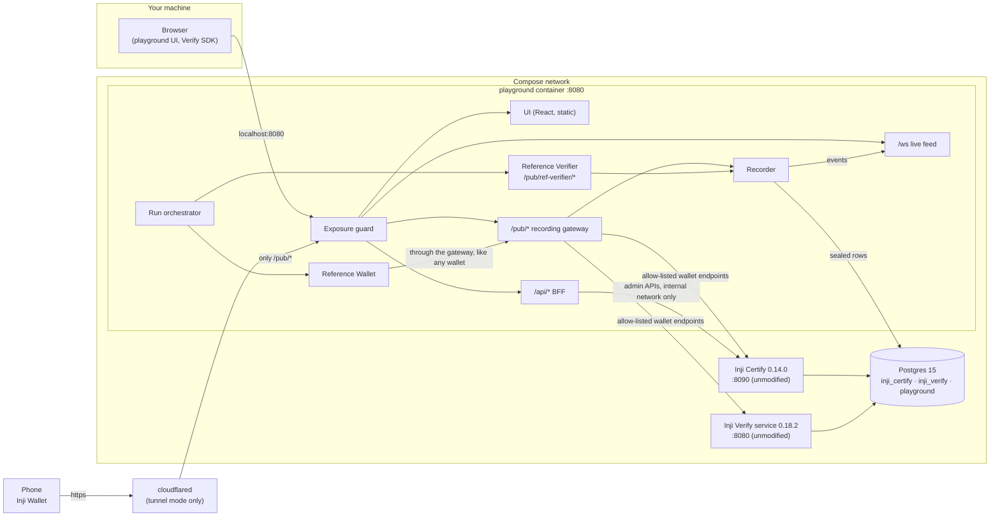
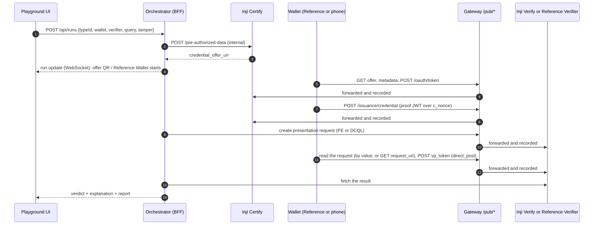
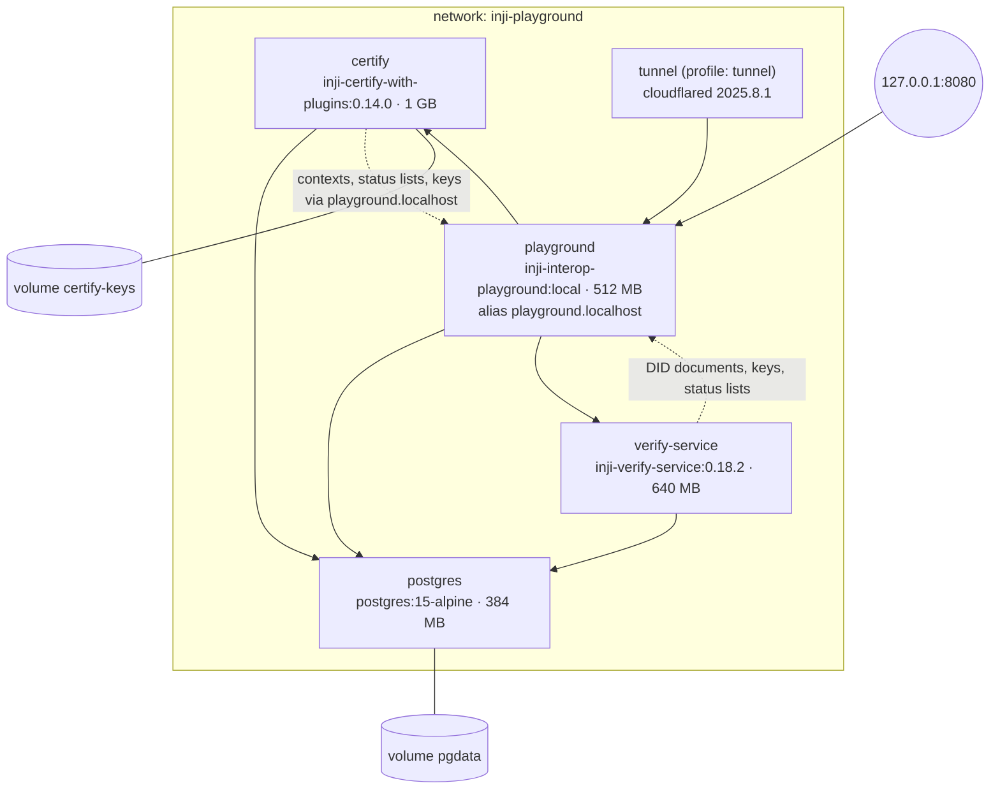

# Architecture

The playground is one Docker Compose bundle: Postgres, **Inji Certify 0.14.0**, **Inji Verify 0.18.2** and the
**playground** container. Only the playground publishes a port. It serves the UI, the API and the recording
gateway on **one origin**, so a browser, a phone wallet and the Inji services all reach the same URL, and every
protocol message that crosses the gateway is recorded.



## The pieces

| Piece | Where | What it does |
|---|---|---|
| UI | [apps/ui](../apps/ui) | React 18 + Vite + Tailwind, Motion for animation. Pages: Run, Run detail (transit line, inspector, sequence diagram), Issuer Studio, Verifier desk, Wallet, Results, Capabilities (with the QR Lab), Live traffic. Built into `apps/ui/dist` and served by the BFF. |
| BFF API | [apps/bff/src/api](../apps/bff/src/api) | Express routes under `/api/*`: Studio, runs and events, Reference Wallet, insights. See [api.md](api.md). |
| Recording gateway | [apps/bff/src/gateway](../apps/bff/src/gateway) | Reverse proxy for `/pub/certify/*` and `/pub/verify/*`. An allow-list passes only wallet-facing endpoints; every exchange is classified (who → whom, which protocol step) and recorded. |
| Public documents | [apps/bff/src/public](../apps/bff/src/public) | `/pub/issuers/*` (DID documents, keys, issuer profiles, logos, SD-JWT type metadata) and `/pub/contexts/*` (JSON-LD contexts for Studio types). |
| Issuer Studio | [apps/bff/src/studio](../apps/bff/src/studio) | Turns an issuer profile and a credential type into a Certify credential configuration (template, context, display, signing suite) and pushes it through `/credential-configurations`. Reconciles Certify with the store at start-up and seeds demo content on a fresh install. |
| Reference Wallet | [apps/bff/src/reference/wallet](../apps/bff/src/reference/wallet) | An independent OpenID4VCI + OpenID4VP holder (below). |
| Reference Verifier | [apps/bff/src/reference/verifier](../apps/bff/src/reference/verifier) | An independent OpenID4VP relying party with PE and DCQL (below). |
| Run orchestrator | [apps/bff/src/runs](../apps/bff/src/runs) | Drives a run through issue → request → present → verify, waits for a human wallet when needed, applies tamper presets, decides PASS/FAIL against the expectation and writes the plain-English explanation and report. |
| Core | [packages/core](../packages/core) | Shared types and pure logic: the Studio model, PE and DCQL builders and matcher, SD-JWT/JWT/offer decoders, secret masking. Used by both the BFF and the UI. |
| Inji Certify | `injistack/inji-certify-with-plugins:0.14.0` | Issuer. Configuration only: [infra/certify](../infra/certify). |
| Inji Verify | `injistack/inji-verify-service:0.18.2` | Verifier backend. Configuration only (environment in [compose.yml](../infra/compose.yml)). The UI's Verifier desk uses Inji's own React SDK `@injistack/react-inji-verify-sdk` 0.18.1 against it. |
| Postgres | `postgres:15-alpine` | Three databases, created by [infra/postgres/init](../infra/postgres/init). |

## One origin

Everything a person or a wallet touches is on one origin (`http://localhost:8080` locally, an `https://` URL in
tunnel mode):

| Path | Served by | Who uses it |
|---|---|---|
| `/` and client routes | UI static files | People |
| `/api/*` | BFF | The UI |
| `/ws` | WebSocket live feed | The UI |
| `/pub/certify/*` | Gateway → Certify | Wallets (OpenID4VCI) |
| `/pub/verify/*` | Gateway → Verify | Wallets (OpenID4VP), the Verify SDK in the browser |
| `/pub/ref-verifier/*` | Reference Verifier | Wallets |
| `/pub/issuers/*`, `/pub/contexts/*`, `/pub/vct/*` | Public documents | Verifiers, wallets, Certify, Verify |

One origin means one tunnel for a phone, no CORS or third-party-cookie problems for the Verify SDK (its session
cookie is scoped to `/pub/verify/v1/verify`), and one place to record traffic. Inside the Compose network the
playground container has the alias `playground.localhost`, and browsers resolve `*.localhost` to loopback, so
`http://playground.localhost:8080` works for the laptop's browser, Certify and Verify alike. That makes it a
valid local `PUBLIC_BASE_URL`.

## Inji services stay unmodified

Certify and Verify run as released images. The playground supplies only configuration: Spring property
overrides, database init scripts and environment variables. Where the reference setup is broken, the fix is in
those files with a comment, and the problem is logged in [gaps.md](gaps.md) (G3, G4, G5, G12, G18).

Wallets never reach Certify or Verify directly. The gateway ([proxy.ts](../apps/bff/src/gateway/proxy.ts))
has an allow-list per upstream:

- **Certify:** issuer and authorization-server metadata, `did.json`, `jwks.json`, credential-offer data, the
  token endpoint, the credential endpoint, status lists, rendering templates.
- **Verify:** creating and reading VP requests and their status, `direct_post` submission, results,
  `vc-verification` (v1 and v2), `vc-submission`, `did.json`, VP definitions.

Anything else answers `404 not_exposed`. Certify's admin APIs (`/credential-configurations`,
`/pre-authorized-data`, the ledger, status updates) have no authentication in the reference setup, so the BFF
calls them only over the internal Compose network, and they are never reachable from outside.

## Reference Wallet and Reference Verifier

Testing Inji against itself would hide shared assumptions, so both reference parties are written from the specs
on independent libraries, not Inji code:

| | Reference Wallet | Reference Verifier |
|---|---|---|
| Protocols | OpenID4VCI draft 13, pre-authorized code (with optional `tx_code`); OpenID4VP, cross-device `direct_post`, `request_uri` or by value | OpenID4VP, `direct_post`. Runs send the request by value with `client_id` = the response URI (`redirect_uri:` prefix for DCQL); a DID-signed request object (`oauth-authz-req+jwt`) at `/pub/ref-verifier/requests/:id` is implemented but not yet used by runs |
| Query languages | Presentation Exchange (both Inji's and the spec's filter dialects) and DCQL | Presentation Exchange and DCQL |
| Formats | `ldp_vc` (VCDM 1.1 and 2.0), `vc+sd-jwt` | the same |
| Holder keys | A fresh key per credential: Ed25519 as `did:key` (JSON-LD), P-256 as `did:jwk` (SD-JWT) | — |
| Checks | Verifies the verifier's signed request object against its DID (did:web, did:key, did:jwk) | State, nonce and audience; holder proof present and signed by the key the credential is bound to; issuer signature; SD-JWT shape, disclosure digests, KB-JWT and `sd_hash`; expiry; revocation; issuer trust (an SD-JWT's key must be one of Certify's published JWKS keys, not just whatever `x5c` says) |
| Libraries | `jose`, `@digitalbazaar/vc`, `@digitalbazaar/ed25519-signature-2020`, `jsonld`, `@peculiar/x509`, `@injistack/pixelpass` for direct share | the same, plus Node's `X509Certificate` |

The Reference Wallet calls Certify and Verify **through the gateway**, like any outside wallet, so its traffic
is recorded the same way a phone's is. Tamper presets (alter a claim, stale nonce, drop the holder proof, someone
else's credential, a forged SD-JWT with a self-signed `x5c`) are applied inside the Reference Wallet just before
it answers.

## A run, end to end



Every arrow through the gateway becomes an event. Each event is attributed to its run in two ways:

1. **Identifiers.** A run registers values it created or learned: offer id, pre-authorized code, access token,
   Verify request and transaction ids, nonces. A message containing one of them belongs to that run, and
   identifiers found in its response are learned too (the access token from a token response, for example).
2. **Waiting runs.** While a run shows a QR code to a person, unmatched wallet traffic on that channel goes to it.

This is what lets the inspector show a phone's messages under the right run without any change to Inji Wallet.

## Event store

[store/pg.ts](../apps/bff/src/store/pg.ts) keeps five tables in the `playground` database:

| Table | Cleartext columns | Sealed (AES-256-GCM) |
|---|---|---|
| `issuer_profiles` | the profile (configuration, no personal data) | — |
| `credential_types` | the type (configuration, no personal data) | — |
| `runs` | id, time, status, verdict and the labels the matrix filters on | the whole run, including claim values |
| `run_events` | id, run id, sequence, time, parties, method, path, status, title, phase, labels | request and response (headers and bodies) |
| `held_credentials` | a summary (type, format, issuer, dates) | the credential itself |

Each sealed value has a fresh 12-byte IV, and the row id is bound in as additional authenticated data, so a
ciphertext cannot be moved to another row. The key is `EVENT_ENCRYPTION_KEY` (32 random bytes, generated into
`.env` on first start). Rows sealed under an older key are skipped with one warning. A purge runs at start-up and
every hour, deleting runs, events and held credentials older than `RETENTION_DAYS` (7 by default). Without
`DATABASE_URL` (unit tests, a second dev instance) an in-memory store with the same interface is used. See
[security-privacy.md](security-privacy.md).

## Live feed

`/ws` is a WebSocket on the same HTTP server ([ws.ts](../apps/bff/src/ws.ts)). `/ws?run=<id>` subscribes to
one run, and `/ws` subscribes to everything (the Live traffic page). Messages:

```json
{ "type": "hello" }
{ "type": "event", "event": { "id": "…", "runId": "run-…", "seq": 5, "from": "wallet", "to": "certify", "title": "Token request", "status": 200, "labels": ["pre-authorized_code"] } }
{ "type": "run", "run": { "id": "run-…", "status": "running", "steps": [ … ] } }
```

Event summaries carry no bodies; the UI fetches `/api/events/<id>` (with secrets masked) when you open one. A
ping every 25 s keeps connections alive through proxies. The upgrade handler also handles one quirk: Java's
HTTP client in Certify and Verify sends `Upgrade: h2c` on plain GETs, and those requests are handed back to the
HTTP app rather than refused.

## Local and tunnel identities

`./playground.sh` writes the mode into `.env`, and Certify, Verify and the playground read it at boot.

| | Local (`./playground.sh up`) | Tunnel (`./playground.sh tunnel [URL]`) |
|---|---|---|
| Public base URL | `http://playground.localhost:8080` | `https://<quick-tunnel>.trycloudflare.com` or your own HTTPS URL |
| Studio issuers | URL keys: `proof.verificationMethod` = `<base>/pub/issuers/<slug>/keys/<alg>#…` | `did:web:<host>:pub:issuers:<slug>` |
| Certify's own key (status lists) | `<base>/pub/issuers/certify/keys/EdDSA` | `did:web:<host>:pub:issuers:certify` |
| Inji Verify's client DID | `did:web:playground.localhost%3A8080:pub:verify:v1:verify` | `did:web:<host>:pub:verify:v1:verify` |
| SD-JWT `vct` | `<base>/pub/issuers/<slug>/types/<Type>` | the same, or `<base>/pub/vct/<id>` when that would exceed Certify's 100-character column (G24) |
| Who can connect | this machine | a phone; only `/pub/*` is public unless `PUBLIC_UI=true` |
| Verify cookie | `Secure=false` | `Secure=true` |

Local mode uses URL keys because did:web requires HTTPS, and a did:web with a port (`%3A8080`) does not resolve
in Inji Verify 0.18.2 (G17). On a public HTTPS host on port 443 did:web works everywhere, so tunnel mode
switches every party to it. Switching modes re-creates Certify and Verify so they pick up the new identity.
Existing credential types are re-synced to the new base URL by the start-up reconcile.

## Compose topology



- `postgres`, `certify` and `verify-service` publish no ports. The playground waits for Postgres to be
  healthy; Certify and Verify have health checks (Certify's is its public issuer metadata, because its
  `/actuator/health` answers 200 even when it fails, G6).
- The bundle needs about 3 GB of memory with the limits above, plus about 2 GB of images on first start.
- The playground image ([infra/playground.Dockerfile](../infra/playground.Dockerfile)) is a multi-stage build
  on `node:22-alpine`: build the UI and the BFF (an esbuild bundle), `pnpm deploy --prod` the runtime
  dependencies, then copy both into a slim image that runs as `node` with a health check on `/api/health`.
- [infra/compose.dev.yml](../infra/compose.dev.yml) publishes Postgres, Certify and Verify on `127.0.0.1` and
  points them at the host for `playground.localhost`, so the BFF can run on the host with `tsx` during
  development.

## Versions

| Component | Version | Notes |
|---|---|---|
| Inji Certify | 0.14.0 | OpenID4VCI draft 13 (`/vd11`, `/vd12` endpoints also present) |
| Inji Verify service | 0.18.2 | OpenID4VP with Presentation Exchange; no DCQL (that arrives in 1.0) |
| Inji Verify React SDK | 0.18.1 | the latest SDK release for the 0.18 line |
| PixelPass | 0.8.0 | used by the QR Lab and direct share |
| Node.js | 22 | BFF runtime |
