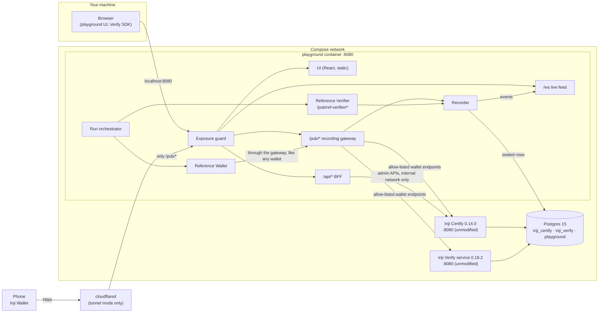
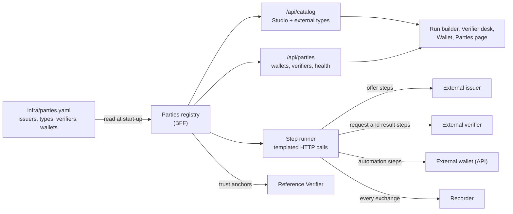
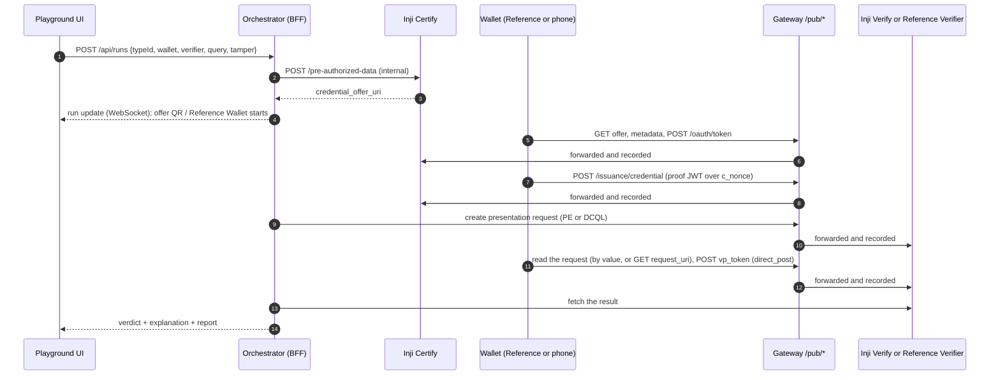
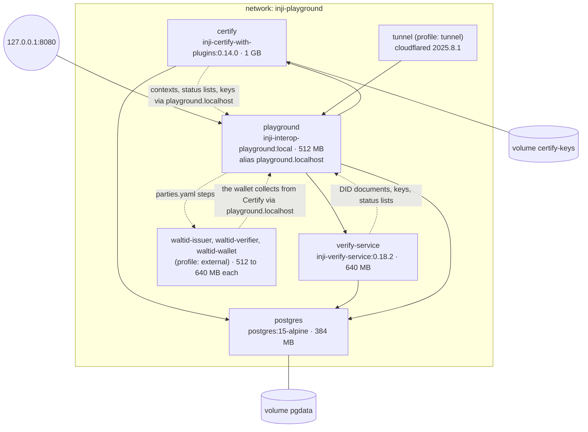

# Architecture

The playground is one Docker Compose bundle. It holds Postgres, **Inji Certify 0.14.0**, **Inji Verify 0.18.2**
and the **playground** container. Only the playground publishes a port. It serves the UI, the API and the
recording gateway on **one origin**. A browser, a phone wallet and the Inji services all reach the same URL, and
the gateway records every protocol message that crosses it.



## The pieces

| Piece | Where | What it does |
|---|---|---|
| UI | [apps/ui](../apps/ui) | React 18, Vite and Tailwind, with Motion for animation. Pages: Run, Run detail (transit line, inspector, sequence diagram), Issuer Studio, Verifier desk, Wallet, Parties, Results, Capabilities (with the QR Lab) and Live traffic. It is built into `apps/ui/dist` and served by the BFF. |
| BFF API | [apps/bff/src/api](../apps/bff/src/api) | Express routes under `/api/*`: Studio, runs and events, Reference Wallet, insights. See [api.md](api.md). |
| Recording gateway | [apps/bff/src/gateway](../apps/bff/src/gateway) | A reverse proxy for `/pub/certify/*` and `/pub/verify/*`. An allow-list passes only the wallet-facing endpoints. Every exchange is classified (who talks to whom, and which protocol step) and recorded. |
| Public documents | [apps/bff/src/public](../apps/bff/src/public) | `/pub/issuers/*` (DID documents, keys, issuer profiles, logos, SD-JWT type metadata) and `/pub/contexts/*` (JSON-LD contexts for Studio types). |
| Issuer Studio | [apps/bff/src/studio](../apps/bff/src/studio) | Turns an issuer profile and a credential type into a Certify credential configuration (template, context, display, signing suite) and pushes it through `/credential-configurations`. At start-up it syncs Certify with the store. On a fresh install it adds demo content. |
| Reference Wallet | [apps/bff/src/reference/wallet](../apps/bff/src/reference/wallet) | An independent OpenID4VCI + OpenID4VP holder (below). |
| Reference Verifier | [apps/bff/src/reference/verifier](../apps/bff/src/reference/verifier) | An independent OpenID4VP relying party with PE and DCQL (below). |
| Parties | [apps/bff/src/parties](../apps/bff/src/parties), [core/parties.ts](../packages/core/src/parties.ts) | Reads [infra/parties.yaml](../infra/parties.yaml) at start-up. It builds a registry of external issuers (with their credential types), verifiers and wallets next to the built-in ones. It runs the HTTP steps the file describes, records each exchange and checks that each party is reachable. It also gives the Reference Verifier the trust anchors of external issuers (see below). |
| Hosted environments | [apps/bff/src/hosted](../apps/bff/src/hosted), [api/hosted.ts](../apps/bff/src/api/hosted.ts) | MOSIP Collab. It reads Mimoto's issuer list and each issuer's OpenID4VCI metadata and turns them into hosted credential types. It signs the Reference Wallet in at eSignet, either automatically with a demo UIN and the static OTP, or through the person's browser and the redirect app on port 3004. It also creates DCQL requests at Collab's Inji Verify 1.0. It is declared under `environments:` in the parties file. See [Hosted environments](#hosted-environments-mosip-collab). |
| Run orchestrator | [apps/bff/src/runs](../apps/bff/src/runs) | Drives a run through issue, request, present and verify. It waits for a human wallet when needed and applies the tamper presets. It decides PASS or FAIL against the expectation and writes the plain-English explanation and the report. |
| Core | [packages/core](../packages/core) | Shared types and pure logic: the Studio model, the PE and DCQL builders and matcher, the SD-JWT, JWT and offer decoders, and secret masking. Both the BFF and the UI use it. |
| Inji Certify | `injistack/inji-certify-with-plugins:0.14.0` | Issuer. Configuration only: [infra/certify](../infra/certify). |
| Inji Verify | `injistack/inji-verify-service:0.18.2` | The verifier backend. Configuration only (the environment is in [compose.yml](../infra/compose.yml)). The UI's Verifier desk uses Inji's own React SDK, `@injistack/react-inji-verify-sdk` 0.18.1, against it. |
| Postgres | `postgres:15-alpine` | Three databases, created by [infra/postgres/init](../infra/postgres/init). |

## One origin

Everything a person or a wallet touches is on one origin. Locally that is `http://localhost:8080`. In tunnel mode it
is an `https://` URL.

| Path | Served by | Who uses it |
|---|---|---|
| `/` and client routes | UI static files | People |
| `/api/*` | BFF | The UI |
| `/ws` | WebSocket live feed | The UI |
| `/pub/certify/*` | Gateway to Certify | Wallets (OpenID4VCI) |
| `/pub/verify/*` | Gateway to Verify | Wallets (OpenID4VP), the Verify SDK in the browser |
| `/pub/ref-verifier/*` | Reference Verifier | Wallets |
| `/pub/issuers/*`, `/pub/contexts/*`, `/pub/vct/*` | Public documents | Verifiers, wallets, Certify, Verify |

One origin gives you three things. A phone needs only one tunnel. The Verify SDK has no CORS or third-party-cookie
problems (its session cookie is scoped to `/pub/verify/v1/verify`). And there is one place to record traffic.
Inside the Compose network, the playground container has the alias `playground.localhost`. Browsers resolve
`*.localhost` to loopback. So `http://playground.localhost:8080` works for the laptop's browser, Certify and
Verify alike, which makes it a valid local `PUBLIC_BASE_URL`.

## Inji services stay unmodified

Certify and Verify run as released images. The playground only supplies configuration: Spring property
overrides, database init scripts and environment variables. Where the reference setup is broken, the fix lives
in those files, with a comment. The problem is logged in [gaps.md](gaps.md) (G3, G4, G5, G12, G18).

Wallets never reach Certify or Verify directly. The gateway ([proxy.ts](../apps/bff/src/gateway/proxy.ts))
keeps an allow-list for each upstream:

- **Certify:** issuer and authorization-server metadata, `did.json`, `jwks.json`, credential-offer data, the
  token endpoint, the credential endpoint, status lists, rendering templates.
- **Verify:** creating and reading VP requests and their status, `direct_post` submission, results,
  `vc-verification` (v1 and v2), `vc-submission`, `did.json`, VP definitions.

Anything else gets `404 not_exposed`. Certify's admin APIs (`/credential-configurations`,
`/pre-authorized-data`, the ledger and status updates) have no authentication in the reference setup. So the BFF
calls them only over the internal Compose network, and nobody can reach them from outside.

## Reference Wallet and Reference Verifier

If we tested Inji against itself, shared assumptions would stay hidden. So both reference parties are written
from the specs, on independent libraries, and use no Inji code:

| | Reference Wallet | Reference Verifier |
|---|---|---|
| Protocols | OpenID4VCI draft 13 with the pre-authorized code (and an optional `tx_code`). OpenID4VP, cross-device `direct_post`, with `request_uri` or by value | OpenID4VP, `direct_post`. Runs send the request by value, with `client_id` set to the response URI (with the `redirect_uri:` prefix for DCQL). A DID-signed request object (`oauth-authz-req+jwt`) at `/pub/ref-verifier/requests/:id` is built but runs don't use it yet |
| Query languages | Presentation Exchange (both Inji's and the spec's filter dialects) and DCQL | Presentation Exchange and DCQL |
| Formats | `ldp_vc` (VCDM 1.1 and 2.0), `vc+sd-jwt` | the same |
| Holder keys | A fresh key per credential: Ed25519 as `did:key` (JSON-LD), P-256 as `did:jwk` (SD-JWT) | n/a |
| Checks | Verifies the verifier's signed request object against its DID (did:web, did:key, did:jwk) | State, nonce and audience. The holder proof must be present and signed by the key the credential is bound to. Issuer signature. SD-JWT shape, disclosure digests, KB-JWT and `sd_hash`. Expiry. Revocation. Issuer trust (an SD-JWT's key must be one of Certify's published JWKS keys, not just whatever `x5c` says) |
| Libraries | `jose`, `@digitalbazaar/vc`, `@digitalbazaar/ed25519-signature-2020`, `jsonld`, `@peculiar/x509`, `@injistack/pixelpass` for direct share | the same, plus Node's `X509Certificate` |

The Reference Wallet calls Certify and Verify **through the gateway**, like any outside wallet. So its traffic is
recorded the same way a phone's is. The tamper presets are applied inside the Reference Wallet, just before it
answers. They are: alter a claim, use a stale nonce, drop the holder proof, present someone else's credential,
and forge an SD-JWT with a self-signed `x5c`.

## External parties

The mentors asked for two things. First, issuers and credential types from other systems should be added **by
configuration and a restart**, and Inji Verify should be able to verify them. Second, the UI should follow that
configuration, with no code changes. The playground does this with one file,
[infra/parties.yaml](../infra/parties.yaml):



- **Nothing vendor-specific is in code.** An entry says where a party is and how to talk to it. It does this as
  a short list of HTTP steps: method, URL, and header and body templates (`${claims}`, `${offerUri}`,
  `${requestUri}`, `${vct}` and so on). `save` rules pick values out of a response (a JSON path, a header, or a
  query parameter of a returned URI) for later steps. Values that should not live in the file come from
  `${file:…}`, `${jwk:…}` (a PEM key as a JWK) and `${env:…}`. These are resolved once, at load.
- **A run with external parties** uses the same four steps.
  - *Issue* runs the issuer's offer steps. If the issuer has no API, it asks the person to paste an offer.
  - *Request* runs the verifier's request steps. Or Inji Verify or the Reference Verifier ask for the external
    type by its `vct` or `typeName`.
  - *Present* drives an API wallet through its automation steps, or waits for a person.
  - *Verify* polls the external verifier's result steps until it gives a verdict. It lists the verifier's own
    policy results as checks.
- **Trust.** Inji Verify 0.18.2 needs no configuration to verify an external issuer's SD-JWT. The Reference
  Verifier only trusts an external issuer through the certificates, JWKs or JWKS URL that its entry lists under
  `trust`.
- **What the playground can't see a person do.** External parties are not behind the gateway. If a phone talks to
  one directly, the playground can't see it, so those steps wait for *Continue*. The playground records
  everything it sends to an external party, and everything the Reference Wallet sends. The inspector shows these
  with an *external party* label.
- **Loading is forgiving.** Each entry is validated on its own (zod schemas in `core/parties.ts`). A broken entry
  is listed on the Parties page and in `/api/parties`, and then skipped. Step definitions never leave the
  server, because their bodies may hold an issuer key or a wallet password.
- **The external lab.** `./playground.sh up --external` adds the `external` Compose profile. It runs walt.id's
  issuer-api, verifier-api and wallet-api 1.0.0 with the configuration in
  [infra/external](../infra/external/README.md). The demo issuer's P-256 key and self-signed certificate are
  generated on the first start and kept out of git.

## Hosted environments (MOSIP Collab)

The playground runs locally and connects *out* to MOSIP Collab. Nothing is deployed there. For a Collab issuer,
the Reference Wallet uses the OpenID4VCI **authorization code** flow instead of the pre-authorized code:

```mermaid
sequenceDiagram
  participant W as Reference Wallet
  participant E as eSignet (Collab)
  participant C as Inji Certify 1.0 (Collab)
  participant V as Inji Verify 1.0 (Collab)
  W->>C: issuer metadata
  W->>E: authorization request (PKCE S256)
  Note over W,E: auto: demo UIN + OTP 111111 through eSignet's API<br/>interactive: the person signs in; eSignet redirects to localhost:3004/redirect
  E-->>W: authorization code
  W->>E: token request (private_key_jwt, wallet-demo key)
  W->>C: nonce, then credential request with a proof JWT
  C-->>W: credential (ldp_vc, dc+sd-jwt or mso_mdoc)
  W->>V: signed DCQL request fetched by request_uri, then the submission
```

Everything goes through the same recorder as local traffic (marked *hosted Inji*). So the inspector, the report
and the sequence diagram work unchanged. A few details differ from the local lane:

- The proof algorithm is chosen from the issuer's advertised list (`Ed25519` or `EdDSA`, gap G39).
- mDoc proofs carry a `jwk` header.
- Verify 1.0 takes DCQL only.

If Collab or the test key is unavailable, hosted types are listed as not collectable. The local bundle is not
affected.

## A run, end to end



Every arrow through the gateway becomes an event. Each event is attributed to its run in two ways:

1. **Identifiers.** A run registers the values it created or learned: offer id, pre-authorized code, access
   token, Verify request and transaction ids, and nonces. A message that contains one of them belongs to that
   run. The run also learns identifiers found in the response, such as the access token in a token response.
2. **Waiting runs.** While a run shows a QR code to a person, any wallet traffic on that channel that matches
   nothing else goes to that run.

This is how the inspector shows a phone's messages under the right run, with no change to Inji Wallet.

## Event store

[store/pg.ts](../apps/bff/src/store/pg.ts) keeps five tables in the `playground` database:

| Table | Cleartext columns | Sealed (AES-256-GCM) |
|---|---|---|
| `issuer_profiles` | the profile (configuration, no personal data) | none |
| `credential_types` | the type (configuration, no personal data) | none |
| `runs` | id, time, status, verdict and the labels the matrix filters on | the whole run, including claim values |
| `run_events` | id, run id, sequence, time, parties, method, path, status, title, phase, labels | request and response (headers and bodies) |
| `held_credentials` | a summary (type, format, issuer, dates) | the credential itself |

Each sealed value has a fresh 12-byte IV. The row id is bound in as additional authenticated data, so a
ciphertext can't be moved to another row. The key is `EVENT_ENCRYPTION_KEY` (32 random bytes, generated into
`.env` on the first start). Rows sealed under an older key are skipped with one warning. A purge runs at start-up
and every hour. It deletes runs, events and held credentials older than `RETENTION_DAYS` (7 by default). Without
`DATABASE_URL` (unit tests, a second dev instance), an in-memory store with the same interface is used. See
[security-privacy.md](security-privacy.md).

## Live feed

`/ws` is a WebSocket on the same HTTP server ([ws.ts](../apps/bff/src/ws.ts)). `/ws?run=<id>` subscribes to
one run. `/ws` subscribes to everything, which is what the Live traffic page uses. The messages look like this:

```json
{ "type": "hello" }
{ "type": "event", "event": { "id": "…", "runId": "run-…", "seq": 5, "from": "wallet", "to": "certify", "title": "Token request", "status": 200, "labels": ["pre-authorized_code"] } }
{ "type": "run", "run": { "id": "run-…", "status": "running", "steps": [ … ] } }
```

Event summaries carry no bodies. When you open an event, the UI fetches `/api/events/<id>` with secrets masked. A
ping every 25 s keeps connections alive through proxies. The upgrade handler also deals with one quirk. The Java
HTTP client in Certify and Verify sends `Upgrade: h2c` on plain GETs. The handler hands those requests back to
the HTTP app instead of refusing them.

## Local and tunnel identities

`./playground.sh` writes the mode into `.env`. Certify, Verify and the playground read it at boot.

| | Local (`./playground.sh up`) | Tunnel (`./playground.sh tunnel [URL]`) |
|---|---|---|
| Public base URL | `http://playground.localhost:8080` | `https://<quick-tunnel>.trycloudflare.com` or your own HTTPS URL |
| Studio issuers | URL keys: `proof.verificationMethod` = `<base>/pub/issuers/<slug>/keys/<alg>#…` | `did:web:<host>:pub:issuers:<slug>` |
| Certify's own key (status lists) | `<base>/pub/issuers/certify/keys/EdDSA` | `did:web:<host>:pub:issuers:certify` |
| Inji Verify's client DID | `did:web:playground.localhost%3A8080:pub:verify:v1:verify` | `did:web:<host>:pub:verify:v1:verify` |
| SD-JWT `vct` | `<base>/pub/issuers/<slug>/types/<Type>` | the same, or `<base>/pub/vct/<id>` when that would exceed Certify's 100-character column (G24) |
| Who can connect | this machine | a phone. Only `/pub/*` is public unless `PUBLIC_UI=true`. |
| Verify cookie | `Secure=false` | `Secure=true` |

Local mode uses URL keys, because did:web needs HTTPS and a did:web with a port (`%3A8080`) does not resolve in
Inji Verify 0.18.2 (G17). On a public HTTPS host on port 443, did:web works everywhere. So tunnel mode switches
every party to it. Switching modes re-creates Certify and Verify so they pick up the new identity. The start-up
sync moves the existing credential types to the new base URL.

## Compose topology



- `postgres`, `certify` and `verify-service` publish no ports. The playground waits for Postgres to be healthy.
  Certify and Verify have health checks. Certify's check reads its public issuer metadata, because its
  `/actuator/health` answers 200 even when it fails (G6).
- With the limits above, the bundle needs about 3 GB of memory, plus about 2 GB of images on the first start. The
  external lab adds about 1.7 GB of limits and 1.5 GB of images.
- The playground image ([infra/playground.Dockerfile](../infra/playground.Dockerfile)) is a multi-stage build on
  `node:22-alpine`. It builds the UI and the BFF (an esbuild bundle) and runs `pnpm deploy --prod` for the
  runtime dependencies. Then it copies both into a slim image that runs as `node`, with a health check on
  `/api/health`.
- [infra/compose.dev.yml](../infra/compose.dev.yml) publishes Postgres, Certify and Verify on `127.0.0.1` and
  points them at the host for `playground.localhost`. This lets you run the BFF on the host with `tsx` while you
  develop.

## Versions

| Component | Version | Notes |
|---|---|---|
| Inji Certify | 0.14.0 | OpenID4VCI draft 13 (`/vd11`, `/vd12` endpoints also present) |
| Inji Verify service | 0.18.2 | OpenID4VP with Presentation Exchange. No DCQL (that arrives in 1.0) |
| Inji Verify React SDK | 0.18.1 | the latest SDK release for the 0.18 line |
| PixelPass | 0.8.0 | used by the QR Lab and direct share |
| walt.id issuer-api, verifier-api, wallet-api | 1.0.0 | optional external lab. OpenID4VCI draft 13, OpenID4VP with PE |
| Node.js | 22 | BFF runtime |
