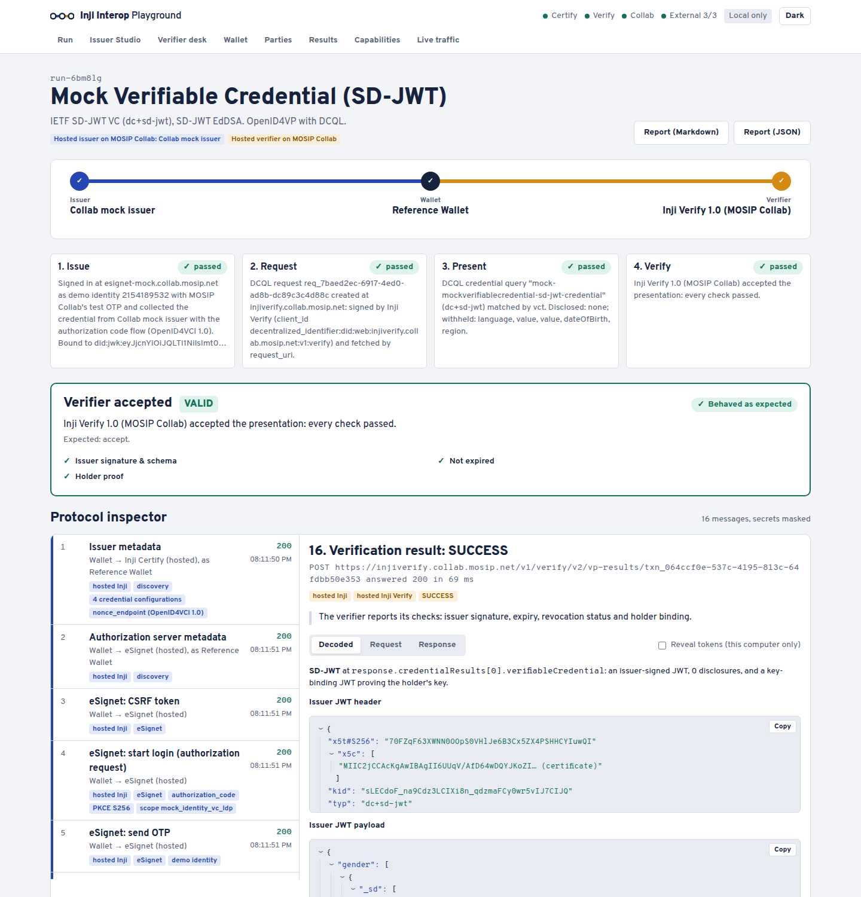

# Using the playground

This guide covers every flow in detail. For setup, start with the [README](../README.md).

## Contents

- [Run each flow](#run-each-flow)
- [Connect to MOSIP Collab](#connect-to-mosip-collab)
- [Use a phone](#use-a-phone)
- [Add parties that are not Inji](#add-parties-that-are-not-inji)
- [Run the whole matrix](#run-the-whole-matrix)

## Run each flow

| I want to | Where to go | What to do |
|---|---|---|
| Design an issuer and credential types | *Issuer Studio* | Pick JSON-LD (VCDM 1.1 or 2.0, eight signature suites) or SD-JWT (ES256, EdDSA, RS256, ES256K). You can also set revocation, selective disclosure per field, a fixed expiry and branding. |
| Issue to the Reference Wallet | *Run* | Pick the wallet *Reference Wallet*. Or open *Wallet*, then *Collect a credential*, and paste any `openid-credential-offer://` link. Links from other issuers work too. |
| Issue to a phone | *Run* | Pick the wallet *Inji Wallet (mobile)* in tunnel mode (see [Use a phone](#use-a-phone)). Scan the offer QR, or tap *Open in wallet app* on the phone. |
| Present with OpenID4VP | *Run*, then *How the holder presents* | Choose *OpenID4VP request*. Pick the query language (Presentation Exchange or DCQL). Use *The verifier asks only for* to limit the claims. |
| Choose how Inji Verify sends its request | *Run*, then *How Inji Verify sends its request* | *Signed, by reference* is the default. It uses Verify's did:web as `client_id` and a small `request_uri` QR. *Unsigned, by value* puts the whole request in the QR (gap G25). |
| Present by direct share | *Run*, then *Direct share* | The credential is compressed with PixelPass, as in a QR code, and Inji Verify checks it. |
| Verify with Inji's own SDK | *Verifier desk*, then *Ask a wallet* | Inji Verify's React SDK shows a request QR that any wallet can scan. On a phone, the same-device button opens the wallet app through an `openid4vp://` deep link. |
| Check a credential's QR code | *Verifier desk*, then *Check a credential's QR code* | Scan or upload a QR. |
| Compare PE and DCQL | *Verifier desk*, then *One question, two query languages* | The same request is shown in both languages side by side. |
| Answer any verifier | *Wallet*, then *Answer a verifier* | Paste an `openid4vp://` request from Inji Verify, the Reference Verifier or another verifier. |
| Tamper on purpose | *Run*, then *Make the wallet misbehave* | Pick one of five presets: alter a claim, answer with a stale nonce, drop the holder proof, present someone else's credential, or forge an SD-JWT with a self-signed certificate. A correct verifier rejects all five. |
| Compare results | *Results* | *Matrix* shows the latest run for each credential, wallet, verifier and presentation style. Known upstream gaps are marked with their id. *History* lists every run and can be filtered. Every run has a Markdown and a JSON report with claim values redacted. |
| See claimed versus proven | *Capabilities* | It compares what Certify and Verify say they support with what runs here have shown. *QR Lab* measures any credential against the QR limits, with and without PixelPass. |
| Watch every message | *Live traffic* | Shows each message through the gateway as it happens. The *Decoder* explains any JWT, SD-JWT, offer, request or PixelPass string. |
| See all parties | *Parties* | Lists every issuer, wallet and verifier, built in or from `infra/parties.yaml`. |

## Connect to MOSIP Collab

MOSIP Collab is MOSIP's hosted sandbox. It is the main target for this playground (AMA 4).
The playground runs on your machine and connects to Collab's Inji Certify issuers, eSignet, Mimoto and Inji Verify 1.0.
The local bundle adds pre-authorized issuance, tampering and CI.

You do not need to configure anything:

- `./playground.sh up` fetches MOSIP's published test client key (`wallet-demo`) into `infra/collab/keys/`.
- The **Collab** dot in the header turns green when the sandbox is reachable.

**Run an end-to-end journey**

1. Open *Run*.
2. Choose the journey *MOSIP Collab, end to end*. Or pick any *MOSIP Collab* issuer with *Inji Verify 1.0 (MOSIP Collab)*.
3. Start the run.

Collab only issues with the authorization code flow. The Reference Wallet signs in at eSignet for you.
It uses one of MOSIP's public demo UINs and the static OTP `111111`.
Choose *I'll sign in myself* if you want to do the eSignet step in your own browser. The redirect is `http://localhost:3004`.

**Collect a Collab credential**

- Open *Wallet*, then *Collect from MOSIP Collab*.
- You can collect the Mock VC (VCDM 1.1, VCDM 2.0 and SD-JWT), Farmer, Land registry and the mDL (`mso_mdoc`), and more.
- A **test data** panel next to every sign-in lists the demo UINs, the OTP and how to register your own UIN.

**Good to know**

- Inji Verify 1.0 speaks DCQL only. It does not support `mso_mdoc` (AMA 4).
- Collab is shared and can change at any time. Findings from it are dated 23 Oct 2026 and name the versions seen.
- With no internet, the matrix skips the Collab rows. Everything local still works.

**What the playground found on Collab**

- Collab's Verify 1.0 fixes G19 and G20. G11 is still there (details withheld).
- Its DCQL claim paths differ from OpenID4VP 1.0 (G36).
- Nobody can verify Collab's Land registry credentials (G41).

The full list is in [gaps.md](gaps.md), G36 to G41.



## Use a phone

A phone wallet needs a public HTTPS URL to reach your computer. The playground can open a Cloudflare quick tunnel without an account.

```bash
./playground.sh tunnel                  # or: ./playground.sh tunnel https://your.domain
./playground.sh doctor                  # also checks the public URL
```

1. Install **Inji Wallet 1.0.0-alpha.1**. This is the version MOSIP points to at collab.mosip.net.
   - [Android APK](https://drive.google.com/drive/folders/1gBjFSdpjxU4bsZi7-xS59W1-EIFKrkS8)
   - [iOS TestFlight](https://testflight.apple.com/join/7FTAdjLe)
   - The GitHub releases do not include one.
2. Open *Run* and pick the wallet *Inji Wallet (mobile)*.
3. Scan the offer QR with the app. Then scan the presentation request QR.
4. The run waits up to 10 minutes for the phone. It attributes the phone's messages to the run, so the inspector fills as it does for the Reference Wallet.

For Collab's issuers you do not need a tunnel. Choose the issuer in the app and sign in with a demo UIN and OTP `111111`. Then present to Collab's Inji Verify.

**How the tunnel works**

- Every party is identified by `did:web` on the public host.
- Only the wallet-facing gateway (`/pub/*`) is reachable through the URL. The UI and the API stay on your computer.
- Set `PUBLIC_UI=true` in `.env` to expose them too. Read [security-privacy.md](security-privacy.md) first.
- The quick-tunnel URL changes every time the tunnel restarts. `./playground.sh up` switches back to local mode.

**What is not tested**

- No run on a physical phone is recorded here. The matrix covers phone flows with the Reference Wallet.
- It is not known whether the alpha wallet can collect a credential from the bundled Certify 0.14.
- It is not known whether the alpha wallet accepts an offer scanned from outside Mimoto's issuer list.

## Add parties that are not Inji

External parties are configuration, not code. [infra/parties.yaml](../infra/parties.yaml) lists each external issuer, verifier and wallet.
Each entry describes how to talk to the party as a few HTTP steps. The steps use placeholders such as `${claims}`, `${offerUri}` and `${requestUri}`.

To add a party:

1. Edit `infra/parties.yaml`.
2. Run `./playground.sh restart`.
3. Open *Parties*. The new party shows up there, in *Run*, in *Verifier desk* and in *Wallet*.

If an entry is broken, the *Parties* page reports it and skips it. The rest still load.

| Party | What the entry needs |
|---|---|
| External issuer | Its OpenID4VCI address, its credential types and the claims they carry. Its `offer` steps ask it for an offer. An issuer without an offer API gets an `offerPage`, and the run asks you to paste an offer. |
| External wallet | A name and install links, if a person scans the QR codes. A wallet with an API can be driven by the playground with `automation.receive` and `automation.present`. |
| External verifier | `request` steps that create an `openid4vp://` request, and `result` steps that read the verdict. Any wallet in the playground can then answer it. |
| Trust | The Reference Verifier only trusts an external issuer's SD-JWTs through the certificates or keys listed under `trust`. |

**Ready-made external parties**

- **walt.id lab.** `./playground.sh up --external` starts an issuer, a verifier and a wallet from the walt.id community stack (API version 1.0.0). See [infra/external/README.md](../infra/external/README.md).
  The shipped `parties.yaml` describes them. They only run on the Docker network, so they work for local runs but not for phones.
- **Animo.** The file also lists Animo's hosted OpenID4VC playground (<https://playground.animo.id>).
  - It is built on Credo, not Inji. It is the external stack the mentors named.
  - It needs no lab. Its API creates a pre-authorized offer for a `dc+sd-jwt` Tax-ID.
  - The Reference Wallet collects it. Inji Verify 0.18.2 and Collab's Verify 1.0 verify it (matrix rows A1 to A4).
  - The Reference Verifier refuses it only because Animo's certificate is not in its trust list. This was checked by hand and is not a matrix row.
- **Hovi.** Hovi's test bed (<https://playground.hovi.id>) is a browser app on a private backend. It has no documented issuer or offer API. The only way to use it is to scan its QR codes with a phone wallet.


## Run the whole matrix

```bash
pnpm install                      # once
cd apps/bff && npx tsx scripts/matrix.ts
```

- It runs 33 journeys with Inji and the reference parties. With the external lab running, it adds 18 more with external parties.
- With internet, it adds 20 against MOSIP Collab and 4 with Animo.
- No person is needed.
- It writes a Markdown report. Set `REPORT=path/to/file.md` to choose where.
- Set `PLAYGROUND_URL` to run it against another host.
